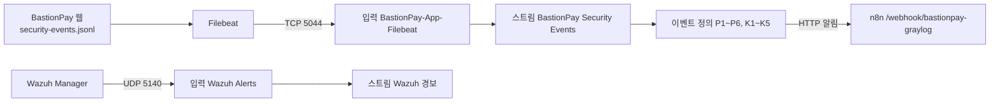

# Graylog 설정 가이드

> BastionPay 보안 이벤트를 Graylog로 수집하고, 이벤트 정의로 n8n에 경보를 보내는 설정 방법입니다.
> 근거 자료: [_graylog/bastionpay-content-pack.json](../../_graylog/bastionpay-content-pack.json), [cjy/lab/bastionpay-content-pack-local.json](../lab/bastionpay-content-pack-local.json), [ops/filebeat.yml](../../ops/filebeat.yml), [README.md](../../README.md) 7장
> 관련 문서: [web-server-setup.md](web-server-setup.md), [wazuh-setup.md](wazuh-setup.md), [n8n-setup.md](n8n-setup.md)

---

## 목차

1. [전체 그림](#1-전체-그림)
2. [Graylog 띄우기](#2-graylog-띄우기)
3. [콘텐츠 팩 가져오기](#3-콘텐츠-팩-가져오기)
4. [입력(Inputs)](#4-입력inputs)
5. [로그 보내는 쪽](#5-로그-보내는-쪽)
6. [스트림 · 파이프라인](#6-스트림--파이프라인)
7. [알림(Notifications)](#7-알림notifications)
8. [이벤트 정의(Event Definitions)](#8-이벤트-정의event-definitions)
9. [within · every · grace 정하기](#9-within--every--grace-정하기)
10. [Search에서 확인하기](#10-search에서-확인하기)
11. [주의할 점](#11-주의할-점)

---

## 1. 전체 그림



| 단계 | 내용 |
|---|---|
| 수집 | 웹 앱이 `logs/security-events.jsonl`에 기록 → Filebeat → Beats 입력(5044). Wazuh Manager는 경보를 Raw UDP 입력(5140)으로 보냄 |
| 분류 | 스트림이 BastionPay 로그와 Wazuh 경보를 나눔. 파이프라인이 `message`를 `이벤트 유형 \| src=IP`로 요약 |
| 탐지 | 이벤트 정의가 조건을 만족하면 HTTP 알림으로 n8n 웹훅 호출 |

> 콘텐츠 팩 요구 버전: **Graylog 6.1.16 이상**

---

## 2. Graylog 띄우기

이 PC(192.168.3.12)의 Graylog는 `graylog/graylog:6.1`, `mongo:6.0`, `opensearchproject/opensearch:2.5.0`로 떠 있습니다.

Filebeat를 받으려면 compose의 `graylog:` → `ports:`에 Beats 포트를 추가합니다.
```yaml
      - "9000:9000"          # 웹 UI
      - "5044:5044/tcp"      # Beats (Filebeat)
```
포트를 추가한 뒤 compose 폴더에서 다시 만듭니다(데이터는 볼륨에 남음).
```bash
docker compose up -d
```

- Wazuh 입력(5140/udp)은 Wazuh Manager가 **같은 Docker 네트워크**에서 컨테이너 이름 `gl-graylog`로 보내면 호스트 포트를 열지 않아도 됩니다. 다른 PC의 Wazuh에서 보낼 거면 `"5140:5140/udp"`도 추가합니다.
- OpenSearch는 반드시 **2.5.0**을 쓰세요(2.15는 색인 오류). `GRAYLOG_ELASTICSEARCH_VERSION`은 넣지 않습니다(자동 감지). 시각이 어긋나지 않게 `GRAYLOG_ROOT_TIMEZONE=Asia/Seoul`을 둡니다.

---

## 3. 콘텐츠 팩 가져오기

입력, 스트림, 파이프라인, 알림, 이벤트 정의가 팩 하나에 들어 있습니다.

| 파일 | 쓰는 경우 |
|---|---|
| `_graylog/bastionpay-content-pack.json` | **빈 Graylog**에 처음 설치 |
| `cjy/lab/bastionpay-content-pack-local.json` | 이미 Wazuh 입력·스트림·파이프라인이 있는 Graylog에 설치(겹치는 항목을 뺀 판) |

1. **System → Content Packs → Upload** → 위 파일 선택 → **Upload**
2. 목록에서 해당 팩 → **Install**

**설치가 실패할 때**: 같은 이름의 파이프라인·스트림이 이미 있으면 `E11000 duplicate key` 오류로 통째로 되돌려집니다. 이 경우 로컬판(`bastionpay-content-pack-local.json`)을 쓰세요. 서버 로그는 이렇게 봅니다.
```bash
docker logs gl-graylog --tail 200 | grep -i "duplicate\|ContentPack"
```

**설치 후 손볼 것**
- **알림 URL**: n8n 주소가 다르면 **Alerts → Notifications**에서 수정
- **이벤트 정의의 스트림 연결**: 스트림 ID가 새로 생기므로, 이벤트 정의 편집 화면에서 `BastionPay Security Events`가 선택됐는지 확인
- **Wazuh 경보 스트림 규칙**: `gl2_source_input` 값이 새 `Wazuh Alerts` 입력 ID와 같은지 확인(`Show received messages`의 주소창에서 ID 확인)

---

## 4. 입력(Inputs)

**System → Inputs**에서 아래가 `RUNNING`인지 확인합니다.

| 입력 | 종류 | 포트 | 주요 설정 | 용도 |
|---|---|---|---|---|
| `BastionPay-App-Filebeat` | Beats | **5044/tcp** | Global, bind 0.0.0.0, TLS 끔, `no_beats_prefix=false` | 웹 앱 보안 이벤트 |
| `Wazuh Alerts` | Raw/Plaintext UDP | **5140/udp** | Global, UTF-8 | Wazuh Manager 경보 |

> `no_beats_prefix=false`라서 Filebeat로 들어온 필드는 **`filebeat_` 접두사**가 붙습니다(`event_type` → `filebeat_event_type`). 모든 검색·이벤트 정의가 이 이름을 씁니다. 포트가 겹쳐 입력이 `FAILED`면 2장 포트·다른 입력과의 충돌을 확인하세요.

---

## 5. 로그 보내는 쪽

**① 웹 앱 → Filebeat → Graylog** ([ops/filebeat.yml](../../ops/filebeat.yml))

핵심 설정은 아래와 같습니다. `app_name`과 `event_source`는 스트림 규칙이 쓰고, 보내는 주소는 Graylog Beats 입력입니다.
```yaml
filebeat.inputs:
  - type: filestream
    paths: [ "<프로젝트 경로>/logs/security-events.jsonl" ]
    parsers:
      - ndjson: { target: "", overwrite_keys: true }
    fields_under_root: true
    fields:
      app_name: bastionpay              # → filebeat_app_name
      event_source: bastionpay_security # → 스트림 규칙
output.logstash:
  hosts: ["<GRAYLOG_HOST>:5044"]
  ssl.enabled: false
```

설치 없이 컨테이너로 띄우는 방법은 [web-server-setup.md](web-server-setup.md)와 같은 요령입니다. Windows에서 `${PWD}`는 비므로 경로를 **절대경로**로 적거나, 컨테이너 실행 시 `-w`로 작업 폴더를 지정합니다.

**② Wazuh Manager → Graylog**: `ossec.conf`의 `syslog_output`으로 레벨 5 이상 경보를 5140으로 보냅니다. 설정은 [wazuh-setup.md 3-1](wazuh-setup.md#3-1-graylog로-경보-보내기-syslog_output)을 보세요.

---

## 6. 스트림 · 파이프라인

**스트림** (System → Streams)

| 스트림 | 규칙 (AND) | 기본 스트림에서 제거 |
|---|---|---|
| `BastionPay Security Events` | `filebeat_event_source` = `bastionpay_security` **AND** `filebeat_app_name` = `bastionpay` | 아니오 |
| `Wazuh 경보` | `gl2_source_input` = (Wazuh Alerts 입력 ID) | 예 |

**파이프라인** (System → Pipelines)

| 파이프라인 | 연결 스트림 | 하는 일 |
|---|---|---|
| `fill-message` | BastionPay Security Events, Default | `message`를 `이벤트 유형 \| src=IP`로 요약(검색 가독성용, 탐지에는 영향 없음) |
| `Wazuh 경보 파싱` | Wazuh 경보 | `ossec: {...}` JSON을 `wazuh_*` 필드로 펼침, FIM 경로 정리, 웹셸 신호 태그 |

> 파이프라인이 동작하려면 **System → Configurations → Message Processors**에서 `Pipeline Processor`가 `Message Filter Chain` **뒤**에 있어야 합니다(스트림 판정 후 실행).

---

## 7. 알림(Notifications)

**Alerts → Notifications** — HTTP Notification

| 항목 | 값 |
|---|---|
| URL | `http://<N8N_HOST>:5678/webhook/bastionpay-graylog` (같은 PC Docker면 `http://host.docker.internal:5678/...`) |
| Method / Content-Type | POST / JSON |
| Body template | 비움 (Graylog 기본 이벤트 JSON 그대로) |

**Execute Test Notification**을 눌러 n8n **Executions**에 실행이 찍히는지 확인합니다(테스트 알림은 내용이 비어 수동 검토로 가는 것이 정상).

---

## 8. 이벤트 정의(Event Definitions)

**Alerts → Event Definitions** — 모두 `Filter & Aggregation` 타입. 공통 설정은 아래와 같습니다.

- **Notifications:** 7장의 알림 연결
- **Message Backlog:** `1` 이상 (n8n이 첫 원본 로그에서 trace_id·member_id 등을 꺼냄)
- **Priority / severity 필드:** 티켓 등급이 됩니다. 9장 참고

### 8-1. 웹 앱 시나리오 (스트림: BastionPay Security Events)
`filebeat_app_name:bastionpay AND` 는 생략했습니다. 등급은 각 정의의 `severity` 필드 값입니다.

| 이름 | 검색 쿼리 | 범위 | 그룹 | 조건 | 등급 |
|---|---|---|---|---|---|
| P1 반복 로그인 실패 | `event_type:LOGIN_FAILURE AND outcome:FAILURE AND reason_code:BAD_CREDENTIALS` | 10분 | source_ip, login_subject_hash | count ≥ 5 | MEDIUM |
| P2 다중 계정 로그인 실패 | 위와 동일 | 5분 | source_ip | card(login_subject_hash) > 4 | MEDIUM 권장 |
| P3 반복 이체 실패·환불 | `event_type:TRANSFER_REFUNDED AND outcome:FAILURE` | 10분 | source_ip, event_type, severity, reason_code | count ≥ 2 | 로그 등급 따름 |
| P5 동일 계정 이체 요청 급증 | `event_type:TRANSFER_REQUESTED` | 5분 | member_id | count ≥ 5 | LOW 권장 |
| P6 서버 API 인증 실패 | `event_type:API_AUTH_FAILED` | 5분 | source_ip | count ≥ 3 | MEDIUM |
| 잠긴 계정 로그인 재시도 | `event_type:LOGIN_FAILURE AND outcome:DENIED AND reason_code:ACCOUNT_LOCKED` | 5분 | source_ip, login_subject_hash | count > 2 | HIGH |
| 차단 IP 요청 | `event_type:IP_BLOCKED_REQUEST` | 5분 | source_ip | count ≥ 2 | MEDIUM |

### 8-2. K 시리즈 (킬체인)
| 규칙 | 스트림 · 쿼리 | 범위 / 실행 | 그룹 | 조건 | 등급 |
|---|---|---|---|---|---|
| K1 웹 스캐너 | BastionPay · `event_type:AUTHENTICATION_REQUIRED` | 1분 / 1분 | source_ip | card(request_path) ≥ 15 | LOW |
| K2 Hydra 브루트포스 | BastionPay · `event_type:LOGIN_FAILURE` | 1분 / 1분 | source_ip | count ≥ 5 | MEDIUM |
| K3 Suricata 경보 폭주 | Default · `rule:ids-alert` | 30초 / 30초 | src_ip | count ≥ 5 | HIGH |
| K4 저속 브루트포스 | BastionPay · `event_type:LOGIN_FAILURE` | 30분 / 5분 | source_ip | count ≥ 8 | MEDIUM |
| K5 네트워크 포트스캔 | Default · `rule:snort-portscan` | 1분 / 1분 | src_ip | count ≥ 1 | MEDIUM |

> K3·K5는 IDS 로그(필드 `rule`, `src_ip`, 접두사 없음)를 대상으로 합니다. 이 저장소에는 IDS 로그를 Graylog로 보내는 설정이 없고 pfSense 백업에 Suricata/Snort가 없으므로 **IDS 센서는 별도 구성**해야 합니다.

### 8-3. ADMIN 권한 (K6)
| 규칙 | 쿼리 | 등급 | 비고 |
|---|---|---|---|
| P4a 권한 탈취 시도 | `event_type:ACCESS_DENIED AND reason_code:INSUFFICIENT_AUTHORITY` | HIGH | n8n이 IP 자동 차단 |
| P4b 권한 승급 침해 | `event_type:TIER_CHANGED AND NOT reason_code:(PROMOTED_BY_VOLUME OR DEMOTED_INACTIVE)` | CRITICAL | n8n이 Telegram·권한 회수·계정 잠금. 제목에 `권한 승급` 포함 필요 |

---

## 9. within · every · grace 정하기

세 값은 역할이 다릅니다.

| 값 | 역할 | 정하는 기준 |
|---|---|---|
| **Search within the last** | "이 공격이 패턴을 다 보여 주는 시간" | 탐지 조건의 N분 (예: "10분 내 5회"면 10분) |
| **Execute search every** | "얼마나 빨리 알아야 하나" | 원하는 탐지 지연. 보통 1~5분 |
| **Grace period** | 같은 키(IP)에 대한 **알림 중복 억제** 시간 | within보다 길게 |

**지켜야 할 규칙**
1. `every ≤ within` — 어기면 검사되지 않는 시간이 생겨 탐지를 놓칩니다.
2. `grace > within` — 같은 로그가 범위에 남는 동안 생기는 경보가 n8n에 다시 가지 않게 합니다.
3. 한 공격당 생기는 **Alert 수 ≈ within ÷ every**. 경보 목록이 많으면 every를 늘립니다(grace는 알림만 억제하고, Alert 생성은 막지 않습니다).

**예: P1 권장** — within 10분 / every 2~5분 / grace 12~15분

**티켓 등급 = Graylog severity**
- n8n은 등급을 ① 이벤트 정의의 `severity` 필드 → ② 첫 원본 로그의 `filebeat_severity` → ③ 우선순위(3=HIGH, 2=MEDIUM, 그 밖 LOW) 순으로 찾습니다.
- 등급을 Graylog에서 일관되게 정하려면 **이벤트 정의마다 `severity` 필드를 직접 적어 둡니다.** 필드를 비우면 backlog나 우선순위에 휘둘립니다.
- 티켓 등급이 HIGH 이상이면 n8n이 IP를 자동 차단하므로, 차단까지 원하지 않는 정의(P1·P2 등)는 MEDIUM 이하로 둡니다.

---

## 10. Search에서 확인하기

1. 웹에서 로그를 하나 만듭니다(예: 로그인 실패).
2. **System → Inputs**의 `BastionPay-App-Filebeat` → **Show received messages**로 이 입력에 들어온 메시지를 바로 봅니다.
3. **Search**에서 시간 범위를 **1 day** 이상으로 두고 `filebeat_app_name:bastionpay`로 검색합니다.
4. 스트림별로 보려면 **Streams → BastionPay Security Events**.

| 증상 | 확인 |
|---|---|
| 입력에는 들어오는데 Search에 없음 | 시간 범위. Filebeat는 처음 실행 때 파일을 처음부터 읽어 원래 발생 시각으로 찍힘 |
| `filebeat_` 접두사가 없음 | 입력의 `No Beats type prefix`가 꺼져 있어야 함 |
| 메시지는 보이는데 경보가 없음 | 이벤트 정의가 활성인지, 실행 주기만큼 기다렸는지 |

---

## 11. 주의할 점

| 항목 | 내용 |
|---|---|
| 평문 전송 | Beats 입력 TLS 꺼짐, Graylog → n8n 알림이 `http://` (내부 실습망 한정). 운영이라면 TLS 적용 |
| 웹훅 인증 없음 | Graylog 알림 헤더가 비어 있음. n8n Graylog 웹훅은 출발지 IP 제한에만 의존 |
| Wazuh 입력 ID | 콘텐츠 팩의 Wazuh 스트림 규칙에 원래 서버 입력 ID가 박혀 있음. 새 입력 ID로 바꿔야 경보가 들어옴 |
| IDS 미연동 | K3·K5용 IDS 로그를 Graylog로 보내는 설정이 저장소에 없음 |
| 콘텐츠 팩 민감정보 | 내부 IP·웹훅 주소 포함. 공개 저장소에 올릴 때 주의 |
