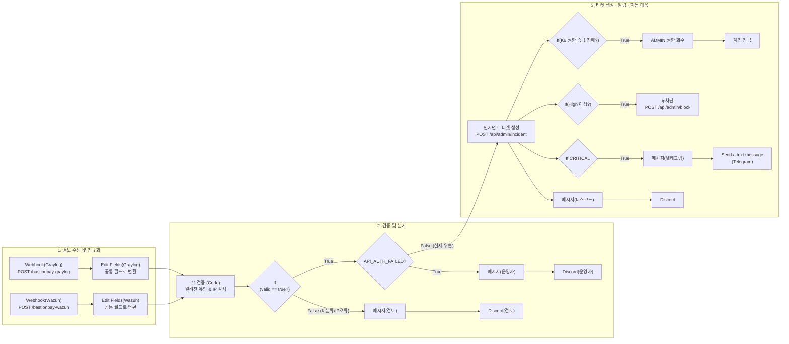

# n8n SOAR 설정 가이드

> BastionPay 보안 관제 자동화 워크플로 **`BastionPay - Security Alert Intake`** 를 n8n에 구성하고 실행하는 방법입니다.
> 근거 자료: [_n8n/BastionPay - Security Alert Intake.json](../../_n8n/BastionPay%20-%20Security%20Alert%20Intake.json), [README.md](../../README.md) 8장
> 경보를 보내는 쪽 설정은 [graylog-setup.md](graylog-setup.md)(Graylog), [wazuh-setup.md](wazuh-setup.md)(Wazuh)를, 망 구성은 [pfsense-setup.md](pfsense-setup.md), 웹 서버 실행은 [web-server-setup.md](web-server-setup.md)를 보세요.

> **이 문서에는 API 키, 웹훅 URL, 봇 토큰 같은 비밀 값이 들어 있지 않습니다.** 각 값은 [3장](#3-비밀-값-만들기발급받기)의 방법으로 직접 만들거나 발급받아 n8n Credential에만 넣으세요.

| 항목 | 값 |
|---|---|
| 워크플로 | `BastionPay - Security Alert Intake` |
| n8n | Docker, `http://<N8N_HOST>:5678` (검증 버전 **2.37.7**) |
| 경보 보내는 곳 | Graylog, Wazuh |
| 호출하는 API | BastionPay 웹 서버 `https://<WEB_HOST>:<포트>/api/admin/...` |

---

## 목차

0. [시작 전에: 주소 정하기](#0-시작-전에-주소-정하기)
1. [워크플로가 하는 일](#1-워크플로가-하는-일)
2. [전체 워크플로 구조](#2-전체-워크플로-구조)
3. [비밀 값 만들기·발급받기](#3-비밀-값-만들기발급받기)
4. [n8n 실행 환경 구성](#4-n8n-실행-환경-구성)
5. [Credential 등록](#5-credential-등록)
6. [가장 빠른 방법: JSON 파일로 구성하기](#6-가장-빠른-방법-json-파일로-구성하기)
7. [노드별 상세 설정](#7-노드별-상세-설정)
8. [Graylog · Wazuh에서 n8n으로 보내기](#8-graylog--wazuh에서-n8n으로-보내기)
9. [동작 테스트](#9-동작-테스트)
10. [문제 해결](#10-문제-해결)
11. [보안 주의사항](#11-보안-주의사항)

---

## 0. 시작 전에: 주소 정하기

| 이름 | 의미 | 이 실습 환경 값 | 들어가는 곳 |
|---|---|---|---|
| `<N8N_HOST>` | n8n을 실행하는 PC | `192.168.3.12` | Graylog 알림 URL, Wazuh `hook_url`, 9장 테스트 |
| `<SIEM_HOST>` | Graylog·Wazuh를 실행하는 PC | `192.168.3.12` (같은 PC) | 4-3 방화벽 허용 규칙 |
| `<WEB_HOST>` | BastionPay 웹 서버 | `192.168.3.12`, 포트 `8080` | HTTP Request 노드 4개 URL, 검증 코드의 IP 보정 값, 인증서 SAN |

> **PC 한 대에 모두 설치한 경우**에도 `localhost` 대신 **실제 LAN IP**를 쓰세요. Docker 컨테이너 안에서 `localhost`는 컨테이너 자신을 가리킵니다. 같은 PC의 호스트를 가리키려면 `host.docker.internal`도 쓸 수 있습니다.

**n8n이 호출하는 웹 서버 API** (모든 요청에 헤더 `X-API-Key: <SECURITY_API_KEY>`)

| API | 요청 본문 | n8n이 쓰는 응답 |
|---|---|---|
| `POST /api/admin/incident` | `src_ip`, `title`, `severity`(`LOW`/`MEDIUM`/`HIGH`/`CRITICAL`), `hours` | `incident.id`, `title`, `severity`, `status`, `src_ip`, `event_count`, `actions` |
| `POST /api/admin/block` | `ip`, `reason` | — |
| `POST /api/admin/revoke` | `member_id`, `reason` | — |
| `POST /api/admin/lock` | `member_id`, `reason` | — |

> **최소 구성으로 먼저 확인하기:** 웹 서버와 Discord만 있으면 9장 테스트 명령으로 수신 → 검증 → 티켓 → 알림 흐름을 확인할 수 있습니다. Graylog·Wazuh는 그다음에 붙여도 됩니다.

---

## 1. 워크플로가 하는 일

Graylog(로그 분석)와 Wazuh(호스트 감시)가 웹훅을 보내면, n8n이 아래 4단계를 자동으로 처리합니다.

1. **수신:** 경보를 받자마자 `HTTP 202`로 응답하고 처리는 뒤에서 합니다.
2. **정규화:** 두 데이터를 **출발지 IP, 제목, 이벤트 종류, 위험도** 같은 공통 필드로 맞춥니다.
3. **검증 및 분류:**
   - 일상 로그(`로그인 성공`, `이체 완료`)는 **폐기**합니다.
   - 처음 보는 경보나 IP가 이상한 경보는 **Discord [🔎 수동 검토 필요]**로 보냅니다.
   - 내부 API 키 오류(`API_AUTH_FAILED`)는 티켓 없이 **Discord [⚠️ 운영자 알림]**으로 보냅니다.
4. **대응 및 전파:**
   - 공격 경보는 웹 서버에 **인시던트 티켓을 생성**합니다. 같은 출발지 IP에 열린 티켓이 있으면 갱신합니다.
   - **모든 등급:** Discord 알림
   - **`HIGH` 이상:** 공격자 IP 자동 차단
   - **`CRITICAL`:** Telegram 비상 알림 추가
   - **ADMIN 권한 승급 침해:** 권한 회수 후 계정 잠금

원칙: **애매한 경보는 버리지 않고 사람에게 넘긴다.**

> **등급과 대응의 관계:** n8n은 대응(IP 차단, Telegram)을 정할 때 **웹 서버가 돌려준 티켓 등급**을 봅니다. 티켓 등급은 Graylog 이벤트 정의의 `severity` 값을 따르고(웹 서버 `IncidentService` 기준), 같은 IP의 열린 티켓은 **올라가기만 하고 내려가지 않습니다.** 그래서 앞서 HIGH가 된 IP는 나중에 MEDIUM 경보가 와도 HIGH로 처리됩니다. 시나리오별로 정확히 보려면 시험 사이에 티켓을 종료하세요.

---

## 2. 전체 워크플로 구조



> 워크플로에 남아 있는 `메시지(슬랙)` → `슬랙` 노드는 비활성 상태이며 이 문서에서는 다루지 않습니다.

---

## 3. 비밀 값 만들기·발급받기

아래 값은 **문서·git·채팅에 적지 않고**, 만들거나 발급받은 즉시 n8n Credential(5장)과 필요한 설정 파일에만 넣습니다.

### 3-1. 웹 서버 API 키 (`SECURITY_API_KEY`)
웹 서버와 n8n이 맞춰 쓰는 값입니다. **직접 만듭니다.**

1. 길고 무작위인 값을 만듭니다.
   ```powershell
   [guid]::NewGuid().ToString("N") + [guid]::NewGuid().ToString("N")
   ```
2. 웹 서버 `.env`의 `SECURITY_API_KEY=`에 넣고 **웹 서버를 재시작**합니다. 비워 두면 `/api/admin/**`가 항상 401입니다.
3. 같은 값을 n8n `Header Auth account` Credential(5장)에 넣습니다.
4. 노출되면 새로 만들어 **두 곳 모두** 바꿉니다.

### 3-2. Discord 웹훅 URL
1. Discord 채널 **⚙ 채널 편집 → 연동 → 웹후크 → 새 웹후크**
2. 이름을 정하고 **웹후크 URL 복사**
3. 티켓·검토·운영자용으로 채널을 나눠도 되고, 하나로 써도 됩니다.

> 웹훅 URL만 있으면 누구나 그 채널에 글을 쓸 수 있습니다. 노출되면 웹후크를 삭제하고 새로 만드세요.

### 3-3. Telegram 봇 토큰과 Chat ID
**봇 토큰**
1. Telegram에서 `@BotFather` → `/newbot` → 이름과 사용자 이름(`..._bot`) 입력
2. 받은 **토큰**(`숫자:영문숫자`)을 복사합니다. 노출되면 `/revoke`로 재발급합니다.

**Chat ID**
1. 만든 봇에게 아무 메시지나 보냅니다.
2. 브라우저에서 `https://api.telegram.org/bot<봇토큰>/getUpdates`를 엽니다.
3. `"chat":{"id":숫자`의 **숫자**가 Chat ID입니다.

### 3-4. Wazuh 웹훅 키
Wazuh 연동 스크립트(`custom-bastionpay-n8n.py`)는 헤더 **`X-Wazuh-Webhook-Key`** 에 Wazuh `ossec.conf`의 `<api_key>` 값을 실어 보냅니다. n8n `Webhook(Wazuh)` 노드의 헤더 인증에 **같은 이름과 값**을 넣어야 합니다. 값은 3-1과 같은 방법으로 만듭니다.

### 3-5. 웹 서버 인증서
n8n이 SSL 검증을 켠 채로 웹 서버를 호출하려면, 웹 서버 인증서의 **SAN에 `<WEB_HOST>`가 들어 있어야** 하고 n8n이 그 인증서를 신뢰해야 합니다. 발급 명령은 [web-server-setup.md 3장](web-server-setup.md#3-개발용-https-인증서-configlocal-devp12)을 따르고, 공개 인증서(`.crt`)를 4-1 위치로 내보냅니다.

---

## 4. n8n 실행 환경 구성

### 4-1. 인증서 위치
이 실습 환경은 웹 서버 공개 인증서를 **`C:\n8n-certs\root-ca.crt`** 에 두고, 컨테이너의 `/etc/n8n-certs/root-ca.crt`로 연결합니다.

```bash
"C:\Program Files\Java\jdk-21.0.12.1\bin\keytool.exe" -exportcert -rfc -alias bastionpay-local -keystore config\local-dev.p12 -storetype PKCS12 -storepass changeit -file C:\n8n-certs\root-ca.crt
```
```bash
certutil -dump C:\n8n-certs\root-ca.crt | findstr /i "DNS IP"
```
마지막 결과에 `<WEB_HOST>` 주소가 보여야 합니다.

### 4-2. n8n 컨테이너 실행
```powershell
docker volume create n8n_data

docker run -d --name n8n --restart unless-stopped `
  -p 5678:5678 `
  -v n8n_data:/home/node/.n8n `
  -v C:\n8n-certs\root-ca.crt:/etc/n8n-certs/root-ca.crt:ro `
  -e NODE_EXTRA_CA_CERTS=/etc/n8n-certs/root-ca.crt `
  -e GENERIC_TIMEZONE=Asia/Seoul `
  -e TZ=Asia/Seoul `
  -e N8N_SECURE_COOKIE=false `
  docker.n8n.io/n8nio/n8n:2.37.7
```

| 옵션 | 의미 |
|---|---|
| `-v n8n_data:...` | 워크플로·Credential·실행 기록 저장. **이 볼륨은 지우지 않습니다** |
| `-v ...root-ca.crt:...:ro` | 인증서를 읽기 전용으로 넣기 |
| `NODE_EXTRA_CA_CERTS` | 넣은 인증서를 신뢰 목록에 추가 |
| `N8N_SECURE_COOKIE=false` | 다른 PC에서 `http://`로 UI에 접속할 때 필요 |

- 실행 후 `http://<N8N_HOST>:5678`에 접속해 **관리자 계정(Owner)** 을 만듭니다.
- **인증서 파일을 바꾸면** n8n이 시작할 때만 읽으므로 재시작해야 합니다.
  ```bash
  docker restart n8n
  ```

**인증서 신뢰 확인**
```bash
docker exec n8n node -e "require('https').get('https://<WEB_HOST>:8080/login', r => console.log('OK', r.statusCode)).on('error', e => console.log('ERR', e.code))"
```

| 결과 | 의미 |
|---|---|
| `OK 200`, `OK 302` 등 | 성공 |
| `ERR SELF_SIGNED_CERT_IN_CHAIN` 등 | 인증서 미등록 → 4-1, 4-2 확인 |
| `ERR ERR_TLS_CERT_ALTNAME_INVALID` | SAN에 `<WEB_HOST>` 없음 → 인증서 다시 발급 |
| `ERR ECONNREFUSED` | 웹 서버가 꺼져 있거나 주소가 틀림 |

### 4-3. 방화벽
목표: **5678 포트는 Graylog·Wazuh가 있는 `<SIEM_HOST>`에서만 접근**하고 나머지는 차단합니다. 아무나 가짜 경보를 보내지 못하게 하기 위해서입니다.

```powershell
# 1) SIEM 허용
New-NetFirewallRule -DisplayName "n8n 5678 - SIEM only" `
  -Direction Inbound -Protocol TCP -LocalPort 5678 `
  -RemoteAddress <SIEM_HOST> -Action Allow

# 2) 그 외 차단 (차단 규칙이 허용보다 우선하므로 SIEM IP는 범위에서 제외)
New-NetFirewallRule -DisplayName "n8n 5678 - block others" `
  -Direction Inbound -Protocol TCP -LocalPort 5678 `
  -RemoteAddress 0.0.0.0-<SIEM_HOST 바로 앞 주소>,<SIEM_HOST 바로 뒤 주소>-255.255.255.255 `
  -Action Block
```

- 넓게 5678을 여는 기존 규칙, Docker Desktop 설치 때 생긴 프로그램 기반 허용 규칙이 있으면 정리합니다.
- `<SIEM_HOST>`가 바뀌면 두 규칙의 주소를 **모두** 고칩니다.
- 확인: 다른 PC에서 `Test-NetConnection <N8N_HOST> -Port 5678` 결과가 `False`여야 합니다.
- Graylog·Wazuh가 같은 PC의 Docker에 있으면 `host.docker.internal:5678`로 보내는 것이 방화벽 영향을 덜 받습니다.

---

## 5. Credential 등록

`http://<N8N_HOST>:5678` → 왼쪽 **[Credentials] → [Add Credential]**

| 종류 | Credential 이름 | 입력값 | 쓰는 노드 |
|---|---|---|---|
| `Header Auth` | `Header Auth account` | Name: `X-API-Key` / Value: **3-1의 API 키** | 인시던트 티켓 생성, ip차단, ADMIN 권한 회수, 계정 잠금 |
| `Discord Webhook` | `Discord Webhook account` | Webhook URL: **3-2의 URL** | Discord, Discord(검토), Discord(운영자) |
| `Telegram API` | `Telegram account` | Access Token: **3-3의 봇 토큰** | Send a text message |
| `Header Auth` | `Wazuh Webhook` | Name: `X-Wazuh-Webhook-Key` / Value: **3-4의 값** | Webhook(Wazuh) |

> Credential 값은 n8n 안에 암호화되어 저장되고, 워크플로를 JSON으로 내보내도 포함되지 않습니다.

---

## 6. 가장 빠른 방법: JSON 파일로 구성하기

1. **[Workflows] → [Add Workflow]**
2. 오른쪽 위 **`⋯` → `Import from File...`**
3. `_n8n/BastionPay - Security Alert Intake.json` 선택
4. **가져온 뒤 꼭 고칠 것**

| 위치 | 그대로 두면 | 할 일 |
|---|---|---|
| HTTP Request 노드 4개 → URL | 작성자 환경의 주소(`https://192.168.3.16/...`) | `https://<WEB_HOST>:8080/...`로 변경 |
| HTTP Request 노드 4개 → Credential | 연결 안 됨 | `Header Auth account` |
| `Discord`, `Discord(검토)`, `Discord(운영자)` | 연결 안 됨 | `Discord Webhook account` |
| `Send a text message` → Credential, Chat ID | 비어 있거나 다른 사람 ID | `Telegram account`, 3-3의 본인 Chat ID |
| `Webhook(Wazuh)` → Authentication | 연결 안 됨 | `Wazuh Webhook` (Header Auth) |
| HTTP Request 노드 4개 → Options → **Ignore SSL Issues** | JSON에는 **ON**으로 저장됨 | 4-2 인증서 신뢰 확인이 `OK`면 **OFF** |
| `검증` 코드의 `ip = '...'` 보정 값 | 작성자 환경의 웹 서버 주소 | `<WEB_HOST>` 실제 IP |
| 워크플로 **Settings → Error Workflow** | 없는 워크플로를 가리킴 | 비우거나 내 에러 워크플로 지정 |

5. **[Save]** → 토글을 **Active**로 켭니다.

> **CLI로 가져오기:** n8n 컨테이너에서 `n8n import:workflow --input=<파일>`로 가져올 수 있습니다. 같은 ID의 워크플로를 덮어쓰면 **비활성화되므로**, 가져온 뒤 다시 활성화하고 n8n을 재시작하세요.
> ```bash
> docker exec n8n n8n list:workflow --active=true
> ```

> **자동 차단을 빼고 티켓과 알림만 운영하려면** `If(High 이상?)`, `ip차단`, `If(K6 권한 승급 침해?)`, `ADMIN 권한 회수`, `계정 잠금` 노드를 우클릭 → **Deactivate**(단축키 `D`) 하세요.

---

## 7. 노드별 상세 설정

JSON 없이 빈 화면에서 만들거나 노드 내부를 고칠 때 이 장을 봅니다.

> ⚠️ **Expression 입력법:** 값에 `{{ ... }}`가 들어가는 항목은 입력칸 오른쪽 위 **`[Fixed | Expression]`**에서 **Expression**을 먼저 누른 뒤 붙여넣습니다. Expression 모드에서는 맨 앞에 `=`를 치지 않습니다.

> 🔒 **HTTP Request 노드 공통:** 인증서를 등록했다면 **Options → Ignore SSL Issues는 OFF**로 둡니다.

### 7-1. 경보 수신 웹훅 2개 (`Webhook`)

| 설정 항목 | `Webhook(Graylog)` | `Webhook(Wazuh)` |
| :--- | :--- | :--- |
| **HTTP Method** | `POST` | `POST` |
| **Path** | `bastionpay-graylog` | `bastionpay-wazuh` |
| **Authentication** | 없음 | `Header Auth` → `Wazuh Webhook` |
| **Respond** | `Immediately` | `Immediately` |
| **Options ➔ Response Code** | `Custom Code` ➔ **`202`** | `Custom Code` ➔ **`202`** |
| **Options ➔ Response Data** | `{"accepted":true}` | `{"accepted":true}` |

> Graylog JSON(`event.fields.*`, `backlog[]`)과 Wazuh JSON(`alert.rule.*`, `alert.data.*`)의 구조가 달라서 입구를 따로 두고 각각 정규화합니다.

### 7-2. 데이터 정규화 2개 (`Edit Fields / Set`)

#### ① `Edit Fields(Graylog)`
- **Mode:** `Manual Mapping`. 아래 13개 필드(String). `alert_source`만 Fixed, 나머지는 Expression.

| 필드 이름 | 모드 | 값 |
| :--- | :---: | :--- |
| **`src_ip`** | Expression | `{{ [$json.body?.event?.fields?.source_ip, $json.body?.event?.fields?.src_ip, $json.body?.event?.fields?.filebeat_source_ip, $json.body?.event?.group_by_fields?.filebeat_source_ip, $json.body?.event?.group_by_fields?.src_ip, $json.body?.backlog?.[0]?.fields?.filebeat_source_ip, $json.body?.backlog?.[0]?.fields?.source_ip, $json.body?.backlog?.[0]?.fields?.src_ip].find(v => typeof v === 'string' && v && !v.includes('$')) || '' }}` |
| **`title`** | Expression | `{{$json.body?.event_definition_title || $json.body?.event?.message || ''}}` |
| **`event_type`** | Expression | `{{ [$json.body?.event?.fields?.event_type, $json.body?.event?.fields?.rule, $json.body?.backlog?.[0]?.fields?.filebeat_event_type, $json.body?.backlog?.[0]?.fields?.event_type, $json.body?.backlog?.[0]?.fields?.rule].find(v => typeof v === 'string' && v !== '' && !v.includes('${') && !v.includes('{{')) || '' }}` |
| **`severity`** | Expression | `{{ String($json.body?.event?.fields?.severity || $json.body?.backlog?.[0]?.fields?.filebeat_severity || ($json.body?.event?.priority >= 3 ? 'HIGH' : ($json.body?.event?.priority === 2 ? 'MEDIUM' : 'LOW')) || 'LOW').replace(/^=/, '').trim().toUpperCase() }}` |
| **`reason_code`** | Expression | `{{ [$json.body?.event?.fields?.reason_code, $json.body?.backlog?.[0]?.fields?.filebeat_reason_code, $json.body?.backlog?.[0]?.fields?.reason_code].find(v => typeof v === 'string' && v && !v.includes('$')) || '' }}` |
| **`graylog_event_id`** | Expression | `{{ $json.body?.event?.id || $json.body?.backlog?.[0]?.id || '' }}` |
| **`trace_id`** | Expression | `{{ [$json.body?.event?.fields?.trace_id, $json.body?.backlog?.[0]?.fields?.filebeat_trace_id, $json.body?.backlog?.[0]?.fields?.trace_id].find(v => typeof v === 'string' && v && !v.includes('$')) || '' }}` |
| **`member_id`** | Expression | `{{ [$json.body?.event?.fields?.member_id, $json.body?.backlog?.[0]?.fields?.filebeat_member_id, $json.body?.backlog?.[0]?.fields?.member_id].find(v => v !== undefined && v !== null && String(v) !== '' && !String(v).includes('$')) ?? '' }}` |
| **`transfer_id`** | Expression | `{{ [$json.body?.event?.fields?.transfer_id, $json.body?.backlog?.[0]?.fields?.filebeat_transfer_id, $json.body?.backlog?.[0]?.fields?.transfer_id].find(v => v !== undefined && v !== null && String(v) !== '' && !String(v).includes('$')) ?? '' }}` |
| **`amount`** | Expression | `{{ [$json.body?.event?.fields?.amount, $json.body?.backlog?.[0]?.fields?.filebeat_amount, $json.body?.backlog?.[0]?.fields?.amount].find(v => v !== undefined && v !== null && String(v) !== '' && !String(v).includes('$')) ?? '' }}` |
| **`currency`** | Expression | `{{ [$json.body?.event?.fields?.currency, $json.body?.backlog?.[0]?.fields?.filebeat_currency, $json.body?.backlog?.[0]?.fields?.currency].find(v => typeof v === 'string' && v && !v.includes('$')) || '' }}` |
| **`outcome`** | Expression | `{{ [$json.body?.event?.fields?.outcome, $json.body?.backlog?.[0]?.fields?.filebeat_outcome, $json.body?.backlog?.[0]?.fields?.outcome].find(v => typeof v === 'string' && v && !v.includes('$')) || '' }}` |
| **`alert_source`** | **Fixed** | `graylog` |

> **`severity` 찾는 순서:** ① 이벤트 정의의 `severity` 필드 → ② 첫 원본 로그의 `filebeat_severity` (backlog가 있을 때) → ③ 이벤트 정의 우선순위(3=HIGH, 2=MEDIUM, 그 밖=LOW). Graylog에서 등급을 정하려면 **이벤트 정의마다 `severity` 필드를 직접 적어 두는 것**이 가장 확실합니다.

#### ② `Edit Fields(Wazuh)`
- **Mode:** `Manual Mapping`. 아래 16개 필드(String). `alert_source`만 Fixed.

| 필드 이름 | 모드 | 값 |
| :--- | :---: | :--- |
| **`wazuh_rule_id`** | Expression | `{{ $json.body?.alert?.rule?.id || $json.body?.rule?.id || '' }}` |
| **`wazuh_rule_description`** | Expression | `{{ $json.body?.alert?.rule?.description || $json.body?.rule?.description || '' }}` |
| **`wazuh_level`** | Expression | `{{ String($json.body?.alert?.rule?.level ?? $json.body?.rule?.level ?? '') }}` |
| **`alert_source`** | **Fixed** | `wazuh` |
| **`src_ip`** | Expression | `{{ $json.body?.alert?.data?.source_ip || $json.body?.alert?.data?.srcip || $json.body?.alert?.srcip || '' }}` |
| **`title`** | Expression | `{{ String($json.body?.alert?.rule?.id ?? $json.body?.rule?.id ?? '') === '100274' ? 'BastionPay | 차단된 IP의 반복 접근' : ($json.body?.alert?.rule?.description || $json.body?.rule?.description || 'Wazuh 경보') }}` |
| **`event_type`** | Expression | `{{ $json.body?.alert?.data?.event_type || $json.body?.alert?.event_type || '' }}` |
| **`severity`** | Expression | `{{ (() => { const a = $json.body?.alert ?? $json.body ?? {}; const rank = { INFO: 0, LOW: 1, MEDIUM: 2, HIGH: 3, CRITICAL: 4 }; const source = rank[String(a.data?.severity ?? '').toUpperCase()] ?? 0; const level = Number(a.rule?.level ?? 0); const detected = level >= 12 ? 4 : level >= 10 ? 3 : level >= 7 ? 2 : 1; return ['INFO', 'LOW', 'MEDIUM', 'HIGH', 'CRITICAL'][Math.max(source, detected)]; })() }}` |
| **`reason_code`** | Expression | `{{ $json.body?.alert?.data?.reason_code || '' }}` |
| **`event_id`** | Expression | `{{ $json.body?.alert?.data?.event_id || '' }}` |
| **`trace_id`** | Expression | `{{ $json.body?.alert?.data?.trace_id || '' }}` |
| **`member_id`** | Expression | `{{ $json.body?.alert?.data?.member_id ?? '' }}` |
| **`transfer_id`** | Expression | `{{ $json.body?.alert?.data?.transfer_id ?? '' }}` |
| **`amount`** | Expression | `{{ $json.body?.alert?.data?.amount ?? '' }}` |
| **`currency`** | Expression | `{{ $json.body?.alert?.data?.currency || '' }}` |
| **`outcome`** | Expression | `{{ $json.body?.alert?.data?.outcome || '' }}` |

> Wazuh 등급은 원본 로그 등급과 룰 레벨(12 이상 CRITICAL, 10 이상 HIGH, 7 이상 MEDIUM) 중 **높은 쪽**을 씁니다.

### 7-3. 합류 및 검증 (`Code` + `If`)

두 `Edit Fields` 노드의 출력을 모두 **`검증`(Code)** 노드 하나로 연결합니다.

#### ① `검증` (Code, JavaScript, Run Once for All Items)
```javascript
const KNOWN_EVENT_TYPES = new Set([
  'LOGIN_FAILURE', 'ACCOUNT_LOCKED',
  'TRANSFER_REFUNDED', 'TRANSFER_REPLAY', 'TRANSFER_FAILED',
  'TRANSFER_REQUESTED', 'IP_BLOCKED_REQUEST', 'API_AUTH_FAILED',
  'AUTHENTICATION_REQUIRED', 'TIER_CHANGED',
  'ACCESS_DENIED',
  'IDS_ALERT', 'ids-alert',
  'SNORT_PORTSCAN', 'snort-portscan',
]);
const INFO_EVENT_TYPES = new Set(['LOGIN_SUCCESS', 'TRANSFER_COMPLETED']);
const POST_BLOCK_LOGIN_RULE = '100280';
const POST_BLOCK_TRANSFER_RULE = '100281';

const isIp = value => {
  if (typeof value !== 'string') return false;
  const ipv4 = value.match(/^(\d{1,3})\.(\d{1,3})\.(\d{1,3})\.(\d{1,3})$/);
  if (ipv4) return ipv4.slice(1).every(part => Number(part) >= 0 && Number(part) <= 255);
  return /^[0-9a-f:]+$/i.test(value) && value.includes(':');
};

return $input.all()
  .filter(item => !['ROLE_REVOKED'].includes(item.json.event_type))
  .filter(item => {
    const type = item.json.event_type;
    const ruleId = String(item.json.wazuh_rule_id || '');
    // 일반 로그인 성공·이체 완료는 폐기하되, 차단된 IP의 후속 성공(Wazuh 100280)만 통과
    if (type === 'LOGIN_SUCCESS') return ruleId === POST_BLOCK_LOGIN_RULE;
    if (type === 'TRANSFER_COMPLETED') return false;
    return true;
  })
  .map(item => {
    let ip = item.json.src_ip;
    const type = item.json.event_type;
    const ruleId = String(item.json.wazuh_rule_id || '');

    // 파일 변조 등 출발지 IP가 없는 호스트 내부 사건은 웹 서버 자체 IP로 보정
    if ((!ip || ip === '없음') && ruleId) {
      ip = '<WEB_HOST>';   // ← 실제 웹 서버 IP로 바꿔 입력 (예: '192.168.3.12')
    }

    const severity = String(item.json.severity || '').replace(/^=/, '').trim().toUpperCase() || 'LOW';
    const knownWazuhCorrelation = [POST_BLOCK_LOGIN_RULE, POST_BLOCK_TRANSFER_RULE].includes(ruleId);
    const valid = isIp(ip) && (KNOWN_EVENT_TYPES.has(type) || knownWazuhCorrelation || Boolean(ruleId));
    return { json: { ...item.json, src_ip: ip, severity, valid } };
  });
```

#### ② `If` (`검증` 오른쪽)
- Value 1 (Expression): `{{ $json.valid }}` / Operation: `Boolean` ➔ `is true`

> `KNOWN_EVENT_TYPES`에 없는 이벤트는 티켓 없이 수동 검토로 갑니다. 탐지 규칙을 새로 만들면 이 목록에도 추가하세요. IPv6(예: `0:0:0:0:0:0:0:1`)도 IP로 인정합니다.

### 7-4. 예외 처리 갈래 2개

#### 갈래 A: `If`의 **false** ➔ `메시지(검토)` ➔ `Discord(검토)`
1. **`메시지(검토)`** (Edit Fields, `text`, Expression)
   ```text
   🔎 BastionPay 수동 검토 필요 (티켓 미생성)    출처: {{ $json.alert_source }}    제목: {{ $json.title }}    출발지 IP: {{ $json.src_ip || '없음' }}    event_type: {{ $json.event_type || '없음' }}    Wazuh rule: {{ $json.wazuh_rule_id || '-' }}
   ```
2. **`Discord(검토)`**: Connection `Webhook` / Credential `Discord Webhook account` / Message `{{ $json.text }}`

#### 갈래 B: `If`의 **true** ➔ `API_AUTH_FAILED?`
1. **`API_AUTH_FAILED?`** (If): `{{ $json.event_type }}` `is equal to` `API_AUTH_FAILED`
2. **true** ➔ **`메시지(운영자)`** (Edit Fields, `text`, Expression)
   ```text
   ⚠️ BastionPay API 인증 실패 반복
      출발지 IP: {{ $json.src_ip }}
      제목: {{ $json.title }}
      Graylog 이벤트 ID: {{ $json.graylog_event_id }}
      조치: 호출 주체 확인 (티켓 미생성)
   ```
   ➔ **`Discord(운영자)`**: Message `{{ $json.text }}`

### 7-5. `인시던트 티켓 생성` (HTTP Request)

`API_AUTH_FAILED?`의 **false** 출력에 연결합니다.

- **Method:** `POST`
- **URL:** `https://<WEB_HOST>:8080/api/admin/incident`
- **Authentication:** `Generic Credential Type` ➔ `Header Auth` ➔ `Header Auth account`
- **Send Body:** ON / **Body Content Type:** JSON / **Specify Body:** Using Fields Below
- **Body Parameters**
  1. `src_ip` = `{{ $json.src_ip }}`
  2. `title` = `{{ $json.title }}`
  3. `severity` =
     ```javascript
     {{ String($json.severity || '').includes('CRITICAL') ? 'CRITICAL' : (String($json.severity || '').includes('HIGH') ? 'HIGH' : (String($json.severity || '').includes('MEDIUM') ? 'MEDIUM' : 'LOW')) }}
     ```
  4. `hours` = `24` (Fixed)
- **Options:** Ignore SSL Issues **OFF**, Timeout `10000`

> 웹 서버는 티켓 등급으로 `LOW`~`CRITICAL`만 받습니다. 위 식이 `INFO`처럼 그 밖의 값을 **`LOW`로 바꿔** 보내기 때문에, Graylog에서 `INFO`로 정한 경보는 LOW 티켓이 됩니다.

### 7-6. 티켓 생성 후 알림 (Discord & Telegram)

`인시던트 티켓 생성` 출력에서 여러 갈래로 연결합니다.

#### ① 기본 Discord (`메시지(디스코드)` ➔ `Discord`)
1. **`메시지(디스코드)`** (Edit Fields, `text`, Expression)
   ```javascript
   🚨 BastionPay 보안 인시던트
   제목: {{$json.incident.title}}
   심각도/상태: {{$json.incident.severity}} / {{$json.incident.status}}
   출발지 IP: {{$json.incident.src_ip}}
   관련 이벤트 수: {{$json.incident.event_count}}
   조치: {{$json.incident.actions || '없음'}}
   티켓 ID: {{$json.incident.id}}
   상세: BastionPay 보안 대시보드에서 티켓 ID로 확인
   {{ (() => { const v = $('검증').first().json; if (v.alert_source !== 'graylog') return '거래 ID: ' + (v.transfer_id || '-'); const b = $('Webhook(Graylog)').first().json.body ?? {}; const valid = x => x !== undefined && x !== null && String(x).trim() !== '' && !String(x).includes('${'); const backlog = b.backlog ?? []; const ids = [...new Set(backlog.map(m => m.fields?.filebeat_transfer_id ?? m.fields?.transfer_id).filter(valid).map(String))]; if ((v.title ?? '').includes('S3_')) return '관련 거래 ID: ' + (ids.join(', ') || '원본 로그에서 확인'); const one = [b.event?.fields?.transfer_id, backlog[0]?.fields?.filebeat_transfer_id, backlog[0]?.fields?.transfer_id, v.transfer_id].find(valid); return '거래 ID: ' + (one ?? '-'); })() }}
   ```
2. **`Discord`**: Message `{{ $json.text }}`

#### ② CRITICAL 전용 Telegram (`If CRITICAL` ➔ `메시지(텔레그램)` ➔ `Send a text message`)
1. **`If CRITICAL`**: `{{ $json.incident.severity }}` `is equal to` `CRITICAL`
2. **`메시지(텔레그램)`** (true에 연결, `text`, Expression)
   ```text
   🚨 BastionPay 보안 인시던트
   {{$json.incident.title}}
   심각도: {{$json.incident.severity}} / 상태: {{$json.incident.status}}
   출발지 IP: {{$json.incident.src_ip}}
   관련 이벤트: {{$json.incident.event_count}}건
   조치: {{$json.incident.actions || '없음'}}
   티켓 ID: {{$json.incident.id}}
   ```
3. **`Send a text message`** (Telegram): Credential `Telegram account`, Resource `Message` / Operation `Send Message`, Chat ID = 본인 Chat ID, Text `{{ $json.text }}`

### 7-7. 자동 대응

#### ① HIGH 이상 IP 자동 차단 (`If(High 이상?)` ➔ `ip차단`)
1. **`If(High 이상?)`**: `{{ ['HIGH', 'CRITICAL'].includes($json.incident?.severity) }}` `is true`
2. **`ip차단`** (HTTP Request, true에 연결)
   - `POST https://<WEB_HOST>:8080/api/admin/block`, Header Auth `Header Auth account`
   - Specify Body: **Using JSON**
     ```javascript
     {{ JSON.stringify({ ip: $('인시던트 티켓 생성').item.json.incident.src_ip, reason: "SOAR 자동 차단: " + $('인시던트 티켓 생성').item.json.incident.title }) }}
     ```

#### ② 권한 승급 침해 시 권한 회수·계정 잠금 (`If(K6 권한 승급 침해?)` ➔ `ADMIN 권한 회수` ➔ `계정 잠금`)
1. **`If(K6 권한 승급 침해?)`**: `{{ $json.incident.title }}` `contains` `권한 승급`
2. **`ADMIN 권한 회수`**: `POST https://<WEB_HOST>:8080/api/admin/revoke`
   ```javascript
   {{ JSON.stringify({ member_id: Number($('Edit Fields(Graylog)').item.json.member_id || 1), reason: "SOAR 자동 대응: 비정상 ADMIN 권한 탈취 감지" }) }}
   ```
3. **`계정 잠금`**: `POST https://<WEB_HOST>:8080/api/admin/lock`
   ```javascript
   {{ JSON.stringify({ member_id: Number($('Edit Fields(Graylog)').item.json.member_id || 1), reason: "SOAR 자동 대응: 권한 승급 계정 동결" }) }}
   ```

> ⚠️ **확인할 점**
> 1. **제목 조건:** 티켓 제목에 `권한 승급`이 있어야 실행됩니다. 이 실습 Graylog의 `P4b_비정상 ADMIN 권한 승급 침해 탐지`는 조건에 맞습니다. 같은 IP 티켓은 **마지막 경보 제목으로 덮어써지므로**, 다른 경보가 뒤에 오면 이 갈래는 다시 실행되지 않습니다.
> 2. **member_id 기본값:** 경보에 `member_id`가 없으면 **1번 회원**이 대상이 됩니다. 모의 경보에는 꼭 `member_id`를 넣으세요.
> 3. **웹 서버 제한:** 권한 회수는 ADMIN만, 마지막 관리자와 자기 자신은 불가입니다. 계정 잠금은 잠금 허용 목록(`LOCKOUT_ALLOWLIST`) 계정만 되고 ADMIN은 잠그지 않습니다. 그래서 일반 회원이 대상이면 권한 회수는 "회수 불필요"로 넘어가고 잠금만 적용됩니다.
> 4. **Wazuh 경보:** `$('Edit Fields(Graylog)')`를 참조하므로 Wazuh에서 온 경보가 이 갈래로 오면 오류가 납니다.

---

## 8. Graylog · Wazuh에서 n8n으로 보내기

경보를 만드는 쪽 설정은 각 문서를 따르고, n8n과 맞물리는 값만 정리합니다.

| 보내는 쪽 | 보내는 주소 | 인증 | 설정 위치 |
|---|---|---|---|
| Graylog HTTP 알림 | `http://<N8N_HOST>:5678/webhook/bastionpay-graylog` (같은 PC Docker면 `http://host.docker.internal:5678/...`) | 없음 (방화벽으로 제한) | Graylog **Alerts › Notifications** → [graylog-setup.md 7장](graylog-setup.md#7-알림notifications) |
| Wazuh 연동 스크립트 | `http://<N8N_HOST>:5678/webhook/bastionpay-wazuh` | 헤더 `X-Wazuh-Webhook-Key` | Wazuh `ossec.conf`의 `<integration>` → [wazuh-setup.md 3-2](wazuh-setup.md#3-2-n8n으로-경보-보내기-integration) |

**Wazuh가 보내는 형식** (`custom-bastionpay-n8n.py`)
```json
{
  "source": "wazuh",
  "alert": {
    "rule": { "id": "100268", "description": "…", "level": 10 },
    "data": { "source_ip": "192.168.3.12", "event_type": "LOGIN_FAILURE", "severity": "LOW", "member_id": 2 }
  }
}
```

> `/webhook-test/...` 주소는 n8n 편집 화면에서 **Listen for test event**를 누른 동안에만 열립니다. Graylog·Wazuh에는 반드시 운영 주소 `/webhook/...`를 넣으세요.
> Graylog 알림은 같은 IP에 대해 grace period 동안 한 번만 보냅니다. 경보 목록에는 쌓이는데 n8n 실행이 적은 것은 정상입니다.

---

## 9. 동작 테스트

워크플로를 **Active**로 켠 뒤, 방화벽에서 허용된 PC에서 실행합니다. Windows에서는 `curl.exe`나 Git Bash·WSL을 쓰세요. 결과는 n8n **Executions**와 Discord·Telegram에서 확인합니다.

### 테스트 1: 일반 보안 위협 (티켓 + Discord)
```bash
curl -X POST "http://<N8N_HOST>:5678/webhook/bastionpay-graylog" \
  -H "Content-Type: application/json" \
  -d '{
    "event_definition_title": "BastionPay | K2_Hydra 로그인 브루트포스 탐지",
    "event": { "id": "test-k2-001", "priority": 2,
      "fields": { "source_ip": "192.168.3.202", "event_type": "LOGIN_FAILURE", "severity": "MEDIUM" } }
  }'
```
- **정상 결과:** `MEDIUM` 티켓 생성, Discord 알림

### 테스트 2: CRITICAL 침해 (티켓 + Discord + Telegram + 자동 대응)
```bash
curl -X POST "http://<N8N_HOST>:5678/webhook/bastionpay-graylog" \
  -H "Content-Type: application/json" \
  -d '{
    "event_definition_title": "BastionPay | P4b_비정상 ADMIN 권한 승급 침해 탐지",
    "event": { "id": "test-k6-001", "priority": 3,
      "fields": { "source_ip": "192.168.3.207", "event_type": "TIER_CHANGED", "severity": "CRITICAL", "member_id": "2" } }
  }'
```
- **정상 결과:** `CRITICAL` 티켓, Discord와 Telegram 알림, `192.168.3.207` 차단, member 2(`test@test.com`) 계정 잠금

### 테스트 3: 모르는 경보 유형 (티켓 없음 + Discord 수동 검토)
```bash
curl -X POST "http://<N8N_HOST>:5678/webhook/bastionpay-graylog" \
  -H "Content-Type: application/json" \
  -d '{ "event_definition_title": "알 수 없는 테스트 이벤트",
        "event": { "id": "test-unknown-001", "fields": { "source_ip": "192.168.3.250", "event_type": "UNKNOWN_WEIRD_EVENT" } } }'
```
- **정상 결과:** 티켓 없음, Discord `🔎 BastionPay 수동 검토 필요`

### 테스트 4: API 인증 실패 (티켓 없음 + Discord 운영자 알림)
```bash
curl -X POST "http://<N8N_HOST>:5678/webhook/bastionpay-graylog" \
  -H "Content-Type: application/json" \
  -d '{ "event_definition_title": "BastionPay | 서버 API 인증 실패 반복",
        "event": { "id": "test-api-001", "fields": { "source_ip": "192.168.3.205", "event_type": "API_AUTH_FAILED", "severity": "MEDIUM" } } }'
```
- **정상 결과:** 티켓 없음, Discord `⚠️ BastionPay API 인증 실패 반복`

> 테스트 뒤에는 웹 관리자 화면에서 **차단 IP 해제, 계정 잠금 해제, 티켓 종료**로 상태를 초기화하세요. 실제 공격 트래픽으로 시험하려면 [attack_trigger/README.md](../attack_trigger/README.md)를 보세요.

---

## 10. 문제 해결

| 증상 | 원인 | 해결 |
|---|---|---|
| HTTP Request에서 `self-signed certificate` | 인증서가 n8n에 등록되지 않음 | 4-1, 4-2 확인 후 `docker restart n8n` |
| `Hostname/IP does not match certificate's altnames` | 인증서 SAN에 `<WEB_HOST>` 없음 | 인증서를 다시 발급해 웹 서버·n8n 모두 교체 |
| Discord·Telegram에 `{{$json.incident.title}}`이 그대로 찍힘 | 입력칸이 Fixed 모드 | `[Fixed \| Expression]`에서 Expression 선택 |
| Graylog가 보냈는데 Executions가 없음 | 워크플로 비활성, 방화벽, `localhost` 사용 | Active 확인, 4-3 방화벽, 실제 IP 또는 `host.docker.internal` 사용 |
| 웹훅 호출 시 `404` | 비활성, 주소 오타, `-test` 주소 | `/webhook/bastionpay-graylog` 확인 |
| 티켓 API `401` / `403` | API 키 불일치 | `Header Auth account`와 웹 서버 `SECURITY_API_KEY` 비교, 웹 서버 재시작 |
| 티켓 등급이 보낸 값보다 높게 나옴 | 같은 IP의 열린 티켓이 이미 더 높은 등급 | 티켓을 종료하고 다시 시험 |
| 탐지됐는데 수동 검토로만 감 | 이벤트가 알려진 목록에 없음 | 7-3 `KNOWN_EVENT_TYPES`에 추가 |
| 권한 탈취 경보인데 회수·잠금이 안 됨 | 제목에 `권한 승급` 없음, 대상이 웹 서버 제한에 걸림 | 7-7 확인할 점 참고 |
| Wazuh 경보가 401 | `X-Wazuh-Webhook-Key` 불일치 | 3-4 값을 양쪽에 맞추기 |
| 다른 PC에서 UI 로그인 안 됨 | secure cookie | `N8N_SECURE_COOKIE=false`로 재생성 |
| 가져온 워크플로가 에러 워크플로 오류 | 원래 n8n의 Error Workflow 설정 | 6장 표대로 Settings에서 비우기 |

---

## 11. 보안 주의사항

- **문서·git·채팅에 적으면 안 되는 것:** API 키, Discord 웹훅 URL, Telegram 봇 토큰, Wazuh 웹훅 키, `.env`, 인증서 개인키(`.key`, `.p12`)
- 비밀 값이 노출됐다면 **바로 폐기하고 재발급**합니다(3장).
- 워크플로 JSON에 Credential **값**은 들어가지 않지만, 노드에 직접 적은 값(Chat ID, URL)은 남으니 커밋 전에 확인합니다.
- 저장소의 `_wazuh/wazuh-config/n8n-webhook-key.txt`와 `ossec.conf`의 `<api_key>`에는 실제 웹훅 키가 들어 있습니다. 공개 저장소라면 키를 교체하고 저장소에서 빼세요.
- 권장 `.gitignore`:
  ```gitignore
  .env
  *.key
  *.p12
  *.pfx
  certs/
  n8n_data/
  ```
