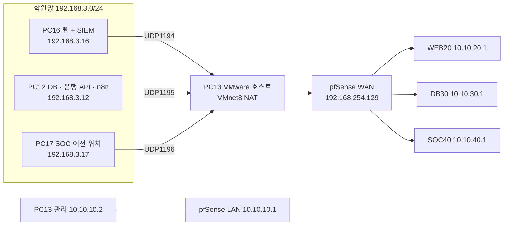

# pfSense 설정 가이드

> BastionPay 프로젝트의 망 분리(pfSense VLAN·OpenVPN·방화벽)를 처음부터 다시 구성할 때 따라 하는 문서입니다.
> 근거 자료: [README.md](../../README.md) 6장, [_pfSense/config-pfsense-pcb.home.arpa-20261104122203.xml](../../_pfSense/config-pfsense-pcb.home.arpa-20261104122203.xml)
> 로그 관제는 [graylog-setup.md](graylog-setup.md), [wazuh-setup.md](wazuh-setup.md)를 보세요.

---

## 목차

1. [전체 그림](#1-전체-그림)
2. [빠른 방법: 백업 XML 복원](#2-빠른-방법-백업-xml-복원)
3. [VMware · 호스트(PC13) 준비](#3-vmware--호스트pc13-준비)
4. [시스템 기본값](#4-시스템-기본값)
5. [인터페이스와 VLAN](#5-인터페이스와-vlan)
6. [OpenVPN TAP](#6-openvpn-tap-서비스-pc를-vlan에-붙이기)
7. [방화벽 규칙](#7-방화벽-규칙)
8. [SOC40 수집 규칙 (백업에 없음)](#8-soc40-수집-규칙-1104-1522-추가-백업에-없음)
9. [NAT](#9-nat)
10. [동작 확인](#10-동작-확인)
11. [주의할 점과 남은 일](#11-주의할-점과-남은-일)

---

## 1. 전체 그림

pfSense VM 한 대가 WAN, 관리 LAN, 서비스 VLAN 6개를 통제합니다. 서비스 PC는 OpenVPN **TAP**으로 각 VLAN에 브리지됩니다. 학원 물리 스위치는 그대로 두고, TAP 이더넷 프레임을 OpenVPN으로 운반해 pfSense 안에서 802.1Q VLAN과 브리지하는 방식입니다.

| 대상 | 주소 |
|---|---|
| pfSense 웹 GUI | `https://10.10.10.1/` (관리 PC `10.10.10.2`에서만) |
| pfSense WAN | `192.168.254.129` (VMware NAT 안) |
| OpenVPN 접속 주소 | `192.168.3.13` (PC13) UDP 1194 / 1195 / 1196 |

> 서비스 PC에는 학원망 주소와 VPN 주소가 함께 있으므로 **VPN만으로 학원망 경로가 사라지지는 않습니다.**

---

## 2. 빠른 방법: 백업 XML 복원

pfSense를 새로 설치했다면 백업을 그대로 올리는 것이 가장 빠릅니다.

1. 관리 PC에서 `https://10.10.10.1/` 접속 (초기 설치 직후라면 기본 LAN 주소 `192.168.1.1`)
2. **Diagnostics › Backup & Restore › Restore Backup**
3. Restore area: `All`, 파일: `_pfSense/config-pfsense-pcb.home.arpa-20261104122203.xml`
4. **Restore Configuration** → 자동 재부팅

> - 백업에는 인증서, 개인 키, TLS 키, 관리자 비밀번호 해시가 들어 있습니다. 저장소 공개 범위에 주의하세요.
> - 복원 후 **NIC 이름이 다르면**(em0/em1/em2가 아닌 경우) Interface Assignments 화면이 뜹니다. WAN=em0(VMnet8 NAT), LAN=em1(관리), em2=VLAN 부모 인터페이스로 다시 지정합니다.
> - 이 백업은 **2026-11-04 12:22** 시점입니다. 같은 날 15:22에 추가한 **SOC40 수집 규칙 8개와 별칭 2개는 들어 있지 않으므로** [8장](#8-soc40-수집-규칙-1104-1522-추가-백업에-없음)을 따라 직접 추가해야 합니다.

아래 3~9장은 백업 내용을 처음부터 손으로 만들 때의 순서입니다.

---

## 3. VMware · 호스트(PC13) 준비

| 항목 | 설정 |
|---|---|
| pfSense VM | pfSense CE 2.7.2-RELEASE, NIC 3개 (em0=VMnet8 NAT, em1=관리망, em2=VLAN 트렁크용) |
| VMnet8 NAT | 호스트 `192.168.254.1`, VMware DHCP에 pfSense WAN MAC을 `192.168.254.129`로 예약 |
| VMware NAT 포트 전달 | UDP 1194 → `192.168.254.129:1194`, UDP 1195 → `:1195`, UDP 1196 → `:1196` (TCP 전달 없음) |
| Windows 방화벽 | UDP 1194는 192.168.3.16에서만, 1195는 .12에서만, 1196은 .17에서만 허용 |
| 영구 경로 | `route -p add 10.10.20.16 mask 255.255.255.255 10.10.10.1` (관리 PC → 웹 서버를 pfSense 경유) |

---

## 4. 시스템 기본값

**System › General Setup / Advanced**

| 항목 | 값 |
|---|---|
| Hostname / Domain | `pfsense-pcb` / `home.arpa` |
| Timezone | `Asia/Seoul` |
| NTP | `2.pfsense.pool.ntp.org` |
| WebGUI | HTTPS, Anti-lockout 규칙 **끔**(`noantilockout`) → 대신 LAN 규칙으로 관리 PC만 허용 |
| SSH | 비활성 |
| DNS Resolver(unbound) | 활성, DNSSEC 켬, Hide identity/version 켬 |
| 추가 패키지 | 없음 |

> Anti-lockout을 끄기 **전에** 7장의 LAN 허용 규칙(ADMIN_HOSTS → 443)을 먼저 만들어야 GUI에서 잠기지 않습니다.

---

## 5. 인터페이스와 VLAN

**Interfaces › Assignments › VLANs**에서 부모 `em2`에 VLAN 6개를 만듭니다.

| 태그 | 설명 | 장치 |
|---|---|---|
| 10 | MGMT10 | em2.10 |
| 20 | WEB20 | em2.20 |
| 30 | DB30 | em2.30 |
| 40 | SOC40 | em2.40 |
| 50 | SOAR50 | em2.50 |
| 60 | TEST60 | em2.60 |

그다음 **Interface Assignments**에서 각 장치를 추가하고 이름과 주소를 지정합니다.

| 할당 | 이름 | 장치 | IPv4 | 비고 |
|---|---|---|---|---|
| wan | WAN | em0 | DHCP (→192.168.254.129) | **Block bogon networks 켬**, Block private networks **끔**(WAN 자체가 사설 대역이므로) |
| lan | LAN | em1 | 10.10.10.1/24 | 관리망 |
| opt1 | WEB20 | em2.20 | 10.10.20.1/24 | |
| opt2 | DB30 | em2.30 | 10.10.30.1/24 | |
| opt3 | SOC40 | em2.40 | 10.10.40.1/24 | |
| opt4 | SOAR50 | em2.50 | 10.10.50.1/24 | 현재 미사용 |
| opt5 | TEST60 | em2.60 | 10.10.60.1/24 | Kali(10.10.60.10) |
| opt6 | MGMT10 | em2.10 | 없음 | 정의만 |
| opt7 | TAPWEB20 | ovpns1 | 없음 | 6장에서 OpenVPN 서버를 만든 뒤 할당 |
| opt8 | TAPDB30 | ovpns2 | 없음 | 〃 |
| opt9 | TAPSOC40 | ovpns3 | 없음 | 〃 |

---

## 6. OpenVPN TAP (서비스 PC를 VLAN에 붙이기)

### 6-1. 인증서
**System › Cert. Manager**

| 종류 | 이름 | 용도 |
|---|---|---|
| CA | `BastionPay-VLAN-CA` | 내부 CA |
| Server cert | `BastionPay-VLAN-Server` | OpenVPN 서버 3개 공용 |
| User cert | `PC16-WEB20`, `PC12-DB30`, `PC17-SOC40` | 클라이언트별. **CN이 아래 `verify-x509-name` 값과 같아야 함** |

### 6-2. 서버 3개
**VPN › OpenVPN › Servers › Add** (세 서버 모두 공통값은 같고, 포트, 브리지 대상, 허용 CN만 다름)

| 공통 항목 | 값 |
|---|---|
| Server mode | Remote Access (SSL/TLS) |
| Device mode | **tap** |
| Protocol / Interface | UDP on IPv4 only / WAN |
| TLS Configuration | TLS Key 사용, 용도 Authentication |
| Peer CA / Server cert | BastionPay-VLAN-CA / BastionPay-VLAN-Server |
| DH / ECDH | 2048 / none |
| Data ciphers | AES-256-GCM, AES-128-GCM, CHACHA20-POLY1305 (Fallback AES-256-GCM) |
| Auth digest | SHA256 |
| Compression | 거절(allow_compression=no) |
| Topology | subnet |
| Concurrent connections | 1 |
| Redirect gateway | 끔 (전체 트래픽을 VPN으로 보내지 않음) |
| Keepalive | 10초 / 60초 |
| Bridge DHCP / Bridge Route Gateway | 켬 / 켬 |

| 서버 설명 | 포트 | Bridge Interface | DHCP 범위 | Custom options | Local network(push) |
|---|---|---|---|---|---|
| TAP_WEB20_PC16 | 1194 | WEB20 | 10.10.20.16–17 | `verify-x509-name PC16-WEB20 name` | 10.10.30.12/32 |
| TAP_DB30_PC12 | 1195 | DB30 | 10.10.30.12–13 | `verify-x509-name PC12-DB30 name` | 10.10.20.16/32 |
| TAP_SOC40_PC17 | 1196 | SOC40 | 10.10.40.17–18 | `verify-x509-name PC17-SOC40 name` | 10.10.10.2/32, 10.10.20.16/32, 10.10.30.12/32 |

### 6-3. 고정 주소 (Client Specific Overrides)
**VPN › OpenVPN › Client Specific Overrides**

| Common Name | 서버 | Tunnel network |
|---|---|---|
| PC16-WEB20 | TAP_WEB20_PC16 | 10.10.20.16/24 |
| PC12-DB30 | TAP_DB30_PC12 | 10.10.30.12/24 |
| PC17-SOC40 | TAP_SOC40_PC17 | 10.10.40.17/24 |

### 6-4. TAP ↔ VLAN 브리지
1. Interface Assignments에서 `ovpns1~3`을 TAPWEB20, TAPDB30, TAPSOC40으로 할당하고 Enable (주소 없음)
2. **Interfaces › Assignments › Bridges › Add**

| 브리지 | 멤버 | 설명 | STP |
|---|---|---|---|
| bridge0 | WEB20 + TAPWEB20 | BR_WEB20_TAP | RSTP |
| bridge1 | DB30 + TAPDB30 | BR_DB30_TAP | RSTP |
| bridge2 | SOC40 + TAPSOC40 | BR_SOC40_TAP | RSTP |

### 6-5. 클라이언트 PC
- **VPN › OpenVPN › Client Export**가 없으므로(패키지 미설치) `.ovpn`을 직접 만들거나 패키지를 설치해 내보냅니다.
- `remote 192.168.3.13 <포트> udp`, `dev tap`, CA, 사용자 인증서, TLS auth 키 포함
- 접속 후 클라이언트 주소가 각각 `10.10.20.16` / `10.10.30.12` / `10.10.40.17`이면 정상 (**Status › OpenVPN**에서 확인)

---

## 7. 방화벽 규칙

**Firewall › Aliases**: `ADMIN_HOSTS` (Host) = `10.10.10.2`

**Firewall › Rules**: 위에서 아래 순서대로 만듭니다(규칙은 위에서부터 첫 일치). 모든 허용 규칙은 **Log 켬**.

**WAN** (OpenVPN 접속을 PC별로만 허용)

| 동작 | 프로토콜 | 출발지 | 목적지 | 설명 |
|---|---|---|---|---|
| Pass | UDP | 192.168.3.17 | WAN address : 1196 | PC17 only to SOC40 OpenVPN UDP1196 |
| Pass | UDP | 192.168.3.16 | WAN address : 1194 | VLAN_TAP_WEB20_from_PC16_UDP1194 |
| Pass | UDP | 192.168.3.12 | WAN address : 1195 | VLAN_TAP_DB30_from_PC12_UDP1195 |
| Pass(비활성) | TCP | 192.168.3.0/24 | 10.10.20.16 : 443 | NAT 포트포워드 연동 규칙(사용 안 함) |

**LAN** (GUI는 관리 PC만)

| 동작 | 프로토콜 | 출발지 | 목적지 | 설명 |
|---|---|---|---|---|
| Block | TCP (IPv6) | any | LAN address : 443 | Block IPv6 pfSense HTTPS |
| Block | TCP | **!** ADMIN_HOSTS | LAN address : 443 | Block non-admin pfSense HTTPS |
| Pass | TCP | ADMIN_HOSTS | LAN address : 443 | Allow admin to pfSense GUI HTTPS |
| Pass | any | LAN net | any | Default allow LAN (IPv4/IPv6). ⚠ 최소 권한 아님, 정리 대상 |
| Pass | TCP | 192.168.3.0/24 | 10.10.20.16 : 443 | ACADEMY_DIRECT_to_WEB20_PC16_HTTPS443 |

**WEB20 · TAPWEB20** (웹 → DB 구간은 필요한 3개 포트만)

| 인터페이스 | 동작 | 출발지 | 목적지 | 설명 |
|---|---|---|---|---|
| WEB20, TAPWEB20 | Pass TCP | 10.10.20.16 | 10.10.30.12 : 3306 | 웹 MySQL |
| WEB20, TAPWEB20 | Pass TCP | 10.10.20.16 | 10.10.30.12 : 3307 | MockBank MySQL |
| WEB20, TAPWEB20 | Pass TCP | 10.10.20.16 | 10.10.30.12 : 8090 | 은행 API |
| WEB20 | Pass TCP | 10.10.20.0/24 | 10.10.30.10 : 3306 | WEB20_to_DB30_test_3306. ⚠ 시험용, 제거 대상 |

> 브리지 구성에서는 패킷이 VLAN 쪽과 TAP 쪽 어느 멤버 인터페이스에서도 평가될 수 있어 **같은 규칙을 양쪽에 둡니다.**

**DB30**

| 동작 | 출발지 | 목적지 | 설명 |
|---|---|---|---|
| Pass TCP/UDP | 10.10.30.10 | 10.10.30.1 : 53 | DB30_Ubuntu_to_pfSense_DNS |
| Pass TCP(비활성) | 10.10.30.10 | any : 80 | 임시 HTTP |

**SOC40 · TAPSOC40**: `10.10.40.17 → SOC40 address` ICMP만 허용 (게이트웨이 ping)

**TEST60**: `10.10.60.10 → 192.168.3.16:8080` 임시 규칙(비활성). 그 외는 기본 차단(Default deny)

---

## 8. SOC40 수집 규칙 (11/04 15:22 추가, 백업에 없음)

WEB20, DB30에서 SOC 서버(`10.10.40.17`)로 **로그 수집 포트만** 열어 줍니다.

**별칭 (Firewall › Aliases › Ports)**

| 이름 | 포트 | 쓰임 |
|---|---|---|
| `SOC40_INGEST_TCP` | 1514, 1515, 5044, 12201 | Wazuh Agent 통신·등록, Filebeat → Graylog Beats, GELF TCP |
| `SOC40_INGEST_UDP` | 1514, 12201 | Wazuh Agent(UDP), GELF UDP |

**규칙 8개** = 2구간(WEB20, DB30) × 2경로(VLAN, TAP) × 2프로토콜(TCP, UDP)

| 인터페이스 | 프로토콜 | 출발지 | 목적지 | 포트 |
|---|---|---|---|---|
| WEB20 / TAPWEB20 | TCP | 해당 구간 net | 10.10.40.17 | SOC40_INGEST_TCP |
| WEB20 / TAPWEB20 | UDP | 해당 구간 net | 10.10.40.17 | SOC40_INGEST_UDP |
| DB30 / TAPDB30 | TCP | 해당 구간 net | 10.10.40.17 | SOC40_INGEST_TCP |
| DB30 / TAPDB30 | UDP | 해당 구간 net | 10.10.40.17 | SOC40_INGEST_UDP |

> 출발지 값은 README에 따로 적혀 있지 않아 "해당 구간 net"으로 적었습니다. 실제 적용한 값은 pfSense 화면에서 확인하거나 최신 백업을 다시 받아 맞추세요.

저장 후 **Apply Changes** → **Status › Filter Reload**가 `Done`인지 확인하고, **Status › System Logs › Firewall**에서 규칙 일치 로그를 봅니다.

> SOC가 PC16으로 옮겨졌으므로 목적지 `10.10.40.17`은 현재 실제 수신처와 맞지 않습니다. 계속 쓰려면 목적지를 새 SOC 주소로 바꿔야 합니다.

---

## 9. NAT

**Firewall › NAT › Outbound** → Mode **Hybrid**

| 인터페이스 | 출발지 | 목적지 | 변환 주소 | 설명 |
|---|---|---|---|---|
| WEB20 | 192.168.3.0/24 | 10.10.20.16/32 : 443 | WEB20 address | ACADEMY_WEB443_return_via_WEB20 |
| WEB20 | 10.10.10.2/32 | 10.10.20.16/32 : 443 | WEB20 address | PC13_MGMT_WEB443_return_via_WEB20 |

→ 웹 서버는 요청 출발지를 `10.10.20.1`로 보게 되어, 응답이 pfSense로 되돌아옵니다(비대칭 경로 방지).

**Port Forward**: `WAN 443 → 10.10.20.16:443` (출발지 192.168.3.0/24, NAT reflection 끔). **비활성** 상태로 둡니다.

---

## 10. 동작 확인

| # | 확인 | 방법 | 기대 결과 |
|---|---|---|---|
| 1 | GUI 접근 제한 | 10.10.10.2 / 다른 LAN 주소에서 `https://10.10.10.1` | 관리 PC만 접속, 나머지 차단 로그 |
| 2 | VPN 접속 | Status › OpenVPN | 3개 서버에 클라이언트 1대씩, 고정 주소, AES-256-GCM |
| 3 | 웹 → DB | PC16에서 `Test-NetConnection 10.10.30.12 -Port 3306` | 성공 + Firewall 로그에 pass |
| 4 | 기본 차단 | Kali(10.10.60.10)에서 허용 안 된 대상 접속 | Default deny 로그 |
| 5 | 수집 포트 | WEB20에서 `Test-NetConnection 10.10.40.17 -Port 5044` | 성공 + SOC40 수집 규칙 일치 로그 |

---

## 11. 주의할 점과 남은 일

| 항목 | 내용 |
|---|---|
| SOC 이전 미반영 | Graylog, Wazuh가 PC17 → PC16으로 옮겨졌으나 SOC40 수집 규칙 목적지는 `10.10.40.17` 그대로 |
| pfSense 로그 미연동 | **Status › System Logs › Settings › Remote Logging** 미설정. 연동하려면 Graylog에 Syslog UDP 입력을 만들고 pfSense에서 원격 syslog 서버로 지정 |
| IDS 미설치 | 백업에 Suricata, Snort 패키지가 없음. Graylog K3·K5, Wazuh 100240~100265 룰은 IDS 센서를 따로 구성해야 동작 |
| 최소 권한 미완 | LAN allow-any 규칙, 시험용 `WEB20 → 10.10.30.10:3306` 규칙이 남아 있음 |
| 학원망 우회 | 서비스 PC가 학원망 주소도 갖고 있어 pfSense를 거치지 않는 경로가 존재 |
| MockBank DB | MySQL이 `127.0.0.1:3307`에 바인딩되어 VPN 구간에서 접속 불가 |
| 백업 민감정보 | pfSense XML에 내부 IP, 인증서, 개인 키 등 포함. 공개 저장소에 올릴 때 주의 |
