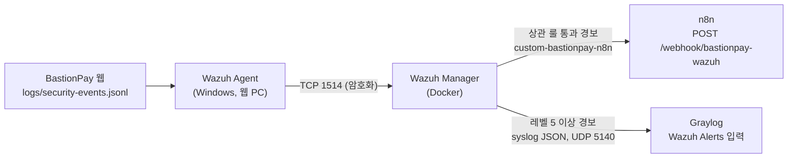

# Wazuh 설정 가이드

> BastionPay 보안 이벤트를 Wazuh로 수집·탐지하고, 결과를 n8n과 Graylog로 보내는 설정 방법입니다.
> 근거 자료: [_wazuh/wazuh-config/](../../_wazuh/wazuh-config/) (`ossec.conf`, `agent.conf`, `local_decoder.xml`, `local_rules.xml`, `integrations/`), [README.md](../../README.md) 7장

---

## 0. 전체 구조



| 구성 요소 | 위치 | 역할 |
|---|---|---|
| Wazuh Agent | 웹 서버 PC (Windows 서비스 `WazuhSvc`) | JSONL 로그 읽기, 배포 폴더 파일 변경 감시(FIM) |
| Wazuh Manager | Docker 컨테이너 `wazuh-manager` (4.9.0) | 디코딩, 룰 매칭, n8n·Graylog 전달 |
| Wazuh Indexer / Dashboard | Docker `wazuh-indexer`, `wazuh-dashboard` | 경보 저장·조회 화면 (선택) |

### 저장소의 파일과 들어갈 위치
| 저장소 파일 | Manager 안 위치 | 내용 |
|---|---|---|
| `ossec.conf` | `/var/ossec/etc/ossec.conf` | Manager 전체 설정. Graylog 전달, n8n 연동 |
| `local_decoder.xml` | `/var/ossec/etc/decoders/local_decoder.xml` | 텍스트 로그(실습 웹앱, Suricata, Snort) 디코더 |
| `local_rules.xml` | `/var/ossec/etc/rules/local_rules.xml` | BastionPay 탐지 룰 (100266~100285) |
| `agent.conf` | `/var/ossec/etc/shared/default/agent.conf` | Agent에 중앙에서 내려보내는 수집·FIM 설정 |
| `bastionpay-agent.conf` | (`agent.conf`와 같은 내용) | 백업용 사본 |
| `integrations/custom-bastionpay-n8n` | `/var/ossec/integrations/custom-bastionpay-n8n` | n8n 전달 실행 파일(셸 래퍼) |
| `integrations/custom-bastionpay-n8n.py` | `/var/ossec/integrations/custom-bastionpay-n8n.py` | n8n 전달 본체(Python) |
| `n8n-webhook-key.txt` | (n8n과 공유하는 키) | `ossec.conf`의 `<api_key>`와 n8n Webhook(Wazuh) 헤더 인증 값 |
| `*.bak*` | — | 수정 이력 백업. 적용하지 않음 |

> ⚠️ `n8n-webhook-key.txt`와 `ossec.conf`의 `<api_key>`에는 실제 웹훅 키가 들어 있습니다. 공개 저장소라면 키를 교체하고 파일을 저장소에서 빼세요.

---

## 1. Manager 띄우기 (Docker)

이 PC의 Manager는 Wazuh 공식 single-node Docker 구성(`wazuh-manager`, `wazuh-indexer`, `wazuh-dashboard`, 4.9.0)으로 떠 있습니다. compose 파일은 이 저장소가 아니라 실습 폴더(`T_folder_2\_10_wazuh`)에 있습니다.

```bash
cd C:\Users\user\Desktop\ALEPH\git_folder\T_folder_2\_10_wazuh
```
```bash
docker compose up -d
```

새로 만든다면 Wazuh 공식 `wazuh-docker` 저장소의 `single-node` 구성을 쓰면 됩니다(인증서 생성 → `docker compose up -d`).

| 포트 | 용도 | 필요 여부 |
|---|---|---|
| TCP 1514 | Agent → Manager 이벤트 전송 | 필수 |
| TCP 1515 | Agent 등록(enrollment) | 필수 |
| 443 | Dashboard 웹 화면 | 선택 |

---

## 2. Manager 설정 파일 넣기

Manager의 `/var/ossec/etc`는 Docker 볼륨이라, 파일을 `docker cp`로 컨테이너 안에 넣습니다. **넣기 전에 기존 파일을 백업**하세요.

### 2-1. 기존 설정 백업
```bash
docker exec wazuh-manager sh -c "cp /var/ossec/etc/ossec.conf /var/ossec/etc/ossec.conf.bak-$(date +%Y%m%d-%H%M%S)"
```

### 2-2. 파일 복사 (프로젝트 루트에서)
```bash
docker cp _wazuh/wazuh-config/ossec.conf wazuh-manager:/var/ossec/etc/ossec.conf
```
```bash
docker cp _wazuh/wazuh-config/local_decoder.xml wazuh-manager:/var/ossec/etc/decoders/local_decoder.xml
```
```bash
docker cp _wazuh/wazuh-config/local_rules.xml wazuh-manager:/var/ossec/etc/rules/local_rules.xml
```
```bash
docker cp _wazuh/wazuh-config/agent.conf wazuh-manager:/var/ossec/etc/shared/default/agent.conf
```
```bash
docker cp _wazuh/wazuh-config/integrations/custom-bastionpay-n8n wazuh-manager:/var/ossec/integrations/custom-bastionpay-n8n
```
```bash
docker cp _wazuh/wazuh-config/integrations/custom-bastionpay-n8n.py wazuh-manager:/var/ossec/integrations/custom-bastionpay-n8n.py
```

### 2-3. 권한 맞추기
Windows에서 복사한 파일은 소유자·권한·줄바꿈이 맞지 않으면 Manager가 읽지 못하거나 연동 스크립트가 실행되지 않습니다.
```bash
docker exec wazuh-manager sh -c "chown root:wazuh /var/ossec/etc/ossec.conf /var/ossec/etc/rules/local_rules.xml /var/ossec/etc/decoders/local_decoder.xml && chown wazuh:wazuh /var/ossec/etc/shared/default/agent.conf && chown root:wazuh /var/ossec/integrations/custom-bastionpay-n8n* && chmod 750 /var/ossec/integrations/custom-bastionpay-n8n* && sed -i 's/\r$//' /var/ossec/integrations/custom-bastionpay-n8n*"
```

### 2-4. 설정 검사 후 재시작
```bash
docker exec wazuh-manager /var/ossec/bin/wazuh-analysisd -t
```
오류가 없으면 재시작합니다.
```bash
docker exec wazuh-manager /var/ossec/bin/wazuh-control restart
```

---

## 3. `ossec.conf`에서 BastionPay용으로 바꾼 부분

기본 Manager 설정에서 아래 세 부분이 프로젝트용입니다.

### 3-1. Graylog로 경보 보내기 (`syslog_output`)
```xml
<syslog_output>
  <server>gl-graylog</server>
  <port>5140</port>
  <format>json</format>
  <level>5</level>
</syslog_output>
```
- 레벨 5 이상 경보를 JSON으로 Graylog의 `Wazuh Alerts` 입력(Raw UDP 5140)에 보냅니다. Graylog 파이프라인 `Wazuh 경보 파싱`이 `wazuh_*` 필드로 펼칩니다.
- `gl-graylog`는 **Graylog 컨테이너 이름**이라, Manager가 Graylog와 **같은 Docker 네트워크**에 있어야 이름이 풀립니다. 이 PC는 Manager가 이미 `9_graylog_default` 네트워크에 붙어 있습니다. Manager 컨테이너를 다시 만들면 다시 연결해야 합니다.
  ```bash
  docker network connect 9_graylog_default wazuh-manager
  ```
- 전송 프로세스(`wazuh-csyslogd`)가 꺼져 있으면 켜고 재시작합니다.
  ```bash
  docker exec wazuh-manager /var/ossec/bin/wazuh-control enable client-syslog
  ```

### 3-2. n8n으로 경보 보내기 (`integration`)
```xml
<integration>
  <name>custom-bastionpay-n8n</name>
  <hook_url>http://192.168.3.12:5678/webhook/bastionpay-wazuh</hook_url>
  <api_key>(n8n-webhook-key.txt 의 값)</api_key>
  <rule_id>100267,100268,100269,100270,100272,100274,100278,100280,100281,100282,100285</rule_id>
  <alert_format>json</alert_format>
</integration>
```
- 지정한 룰 번호의 경보만 n8n으로 보냅니다(기본 룰 100266, 100271처럼 한 건짜리는 보내지 않음).
- 스크립트는 `{"source":"wazuh","alert":{...}}`를 POST하고, 헤더 `X-Wazuh-Webhook-Key`에 `<api_key>` 값을 실어 보냅니다.
- n8n의 **Webhook(Wazuh)** 노드가 이 헤더로 인증합니다. 두 값이 다르면 n8n이 거부합니다.
- `hook_url`은 Manager 컨테이너 안에서 닿는 주소여야 합니다. n8n이 같은 PC에 있으면 `http://host.docker.internal:5678/webhook/bastionpay-wazuh`도 쓸 수 있습니다.

### 3-3. Agent 수신·등록
```xml
<remote>  <connection>secure</connection> <port>1514</port> <protocol>tcp</protocol> </remote>
<auth>    <disabled>no</disabled> <port>1515</port> <use_password>no</use_password> </auth>
```
비밀번호 없이 1515로 등록을 받습니다. 실습망 밖에 노출할 거면 `use_password`를 켜세요.

---

## 4. Agent 설정 (웹 서버 PC, Windows)

### 4-1. 설치와 등록
1. Wazuh Agent(4.9.x, Manager와 같은 버전)를 설치합니다. 이 PC에는 이미 설치돼 있습니다(`WazuhSvc`).
2. `C:\Program Files (x86)\ossec-agent\ossec.conf`의 Manager 주소를 바꿉니다.
   ```xml
   <client>
     <server>
       <address>192.168.3.12</address>   <!-- Manager가 떠 있는 PC 주소 -->
       <port>1514</port>
       <protocol>tcp</protocol>
     </server>
   </client>
   ```
   지금 이 PC는 `127.0.0.1`로 되어 있습니다. Manager가 같은 PC의 Docker에 있으면 그대로 둬도 되고, 다른 PC면 그 주소로 바꿉니다.
3. 등록하고 서비스를 재시작합니다(관리자 권한 명령 프롬프트).
   ```bash
   "C:\Program Files (x86)\ossec-agent\agent-auth.exe" -m 192.168.3.12
   ```
   ```bash
   net stop WazuhSvc && net start WazuhSvc
   ```
4. Manager에서 연결됐는지 확인합니다.
   ```bash
   docker exec wazuh-manager /var/ossec/bin/agent_control -l
   ```
   Agent가 `Active`로 보이면 됩니다.

### 4-2. 중앙 설정(`agent.conf`) — 꼭 고칠 두 곳
`agent.conf`는 Manager가 Agent에 내려보내는 설정입니다. 저장소 파일은 **다른 PC 기준**이라 그대로는 이 PC에 적용되지 않습니다.

```xml
<agent_config name="^DESKTOP-9MIUJ8A$">
  <localfile>
    <location>C:\Users\user\Desktop\bastionpay-run\logs\security-events.jsonl</location>
    <log_format>json</log_format>
    <label key="app_name">bastionpay</label>
    <label key="event_source">bastionpay_security</label>
    <label key="environment">lab</label>
  </localfile>
  <syscheck>
    <directories realtime="yes" check_all="yes">C:\Users\user\Desktop\bastionpay-run</directories>
    <ignore>C:\Users\user\Desktop\bastionpay-run\logs</ignore>
  </syscheck>
</agent_config>
```

| 고칠 곳 | 지금 값 | 바꿀 값 |
|---|---|---|
| `name="^…$"` (적용 대상 Agent 이름) | `DESKTOP-9MIUJ8A` (다른 PC) | 이 PC의 Agent 이름. 이 PC 호스트 이름은 `DESKTOP-IVCFF5M` |
| `<location>`, `<directories>` | `bastionpay-run` (JAR 배포 폴더) | 웹을 실제로 실행하는 폴더. IntelliJ로 실행하면 `C:\Users\user\Desktop\ALEPH\git_folder\project_potpolio\logs\security-events.jsonl` |

- `label`로 붙이는 `app_name=bastionpay`는 BastionPay 룰(`app_name=^bastionpay$`)이 쓰므로 그대로 둡니다.
- FIM은 `logs` 폴더를 제외합니다. 로그가 쓰일 때마다 파일 변경 경보가 나지 않게 하기 위해서입니다.
- 고친 뒤 2-2의 `agent.conf` 복사와 2-3 권한 설정을 다시 하면, 몇 분 안에 Agent가 받아 갑니다. 바로 적용하려면 Agent 서비스를 재시작합니다.

---

## 5. 디코더 (`local_decoder.xml`)

BastionPay 보안 이벤트는 JSON이라 Wazuh 기본 **JSON 디코더**가 필드를 풉니다(`event_type`, `source_ip`, `login_subject_hash` …). 커스텀 디코더는 텍스트 로그용입니다.

| 디코더 | 인식하는 줄 | 뽑는 필드 |
|---|---|---|
| `webapp-login` | `login_failed …` / `login_success …` (실습 웹앱) | `user`, `srcip` |
| `webapp-404` | `http_404 …` (Flask 게시판) | `srcip`, `url` |
| `suricata-alert` | `suricata_alert src_ip=.. sid=.. signature=..` | `srcip`, `id`, `signature` |
| `snort-alert` | `snort_alert src_ip=.. sid=.. signature=..` | `srcip`, `id`, `signature` |

Suricata·Snort 디코더는 IDS 원본(eve.json 등)을 위 한 줄 형식으로 바꿔 주는 별도 포워더가 있어야 동작합니다. 그 포워더는 이 저장소에 없습니다.

---

## 6. 룰 (`local_rules.xml`)

### 6-1. BastionPay 룰 (n8n으로 가는 것 ★)
"기본 룰(한 건) → 상관 룰(반복)" 2단 구조입니다. 기본 룰은 레벨을 낮게 두고, 상관 룰만 n8n으로 보냅니다.

| 룰 | 레벨 | 조건 | 시나리오 |
|---|---|---|---|
| 100266 | 5 | `LOGIN_FAILURE` + `BAD_CREDENTIALS` 한 건 | (기본) |
| ★100267 | 10 | 100266이 **같은 IP·서로 다른 계정**으로 5회 / 5분 | 다중 계정 스프레이 (L2) |
| ★100268 | 10 | 100266이 **같은 IP·같은 계정**으로 5회 / 10분 | 반복 로그인 실패 (S1) |
| ★100269 | 8 | `TRANSFER_REFUNDED` 한 건 | 이체 실패 후 환불 |
| ★100270 | 10 | 100269가 같은 IP·심각도·사유로 2회 / 10분 | 반복 이체 실패·환불 (S3) |
| 100271 | 1 | `API_AUTH_FAILED` 한 건 | (기본) |
| ★100272 | 10 | 100271이 같은 IP로 3회 / 5분 | 서버 API 인증 실패 |
| 100273 | 1 | `IP_BLOCKED_REQUEST` 한 건 | (기본) |
| ★100274 | 10 | 100273이 같은 IP로 2회 / 5분 | 차단 IP 재요청 |
| 100277 | 1 | `TRANSFER_REQUESTED` 한 건 | (기본) |
| ★100278 | 8 | 100277이 같은 회원으로 5회 / 5분 | 동일 계정 이체 요청 급증 |
| ★100280 | 12 | 같은 IP에서 차단 요청 후 10분 안에 **로그인 성공** | 차단 IP 후 로그인 |
| ★100281 | 12 | 같은 IP에서 차단 요청 후 10분 안에 **이체 요청** | 차단 IP 후 이체 |
| ★100282 | 8 | 기본 FIM 룰(550·553·554) + 경로 조건 | 소스 파일 변경 |
| ★100285 | 10 | `TIER_CHANGED` + 사유 `NO_REASON` | 사유 없는 등급 변경 |

### 6-2. 그 밖의 룰 (실습 웹앱·IDS)
| 룰 | 내용 |
|---|---|
| 100210, 100211, 100232, 100233 | 실습 웹앱 로그인 실패, Hydra(6회/2분), 저속 브루트포스(8회/30분), 심야 로그인 |
| 100220, 100221, 100222 | Flask 게시판 템플릿 변경, 웹셸 의심, 실행 파일 삭제 (FIM). Graylog 파이프라인이 100220에 `signal_kind=webshell-file`을 붙임 |
| 100230, 100231 | Flask 게시판 404, 404 폭주(웹 스캐너, 31회/30초) |
| 100240~100243 | Suricata 경보, 포트스캔, SQL Injection, 경보 폭주(6회/30초) |
| 100264, 100265 | Snort 경보, 포트스캔 |

### 6-3. 확인해 둘 점
- **100282의 경로 조건과 FIM 감시 폴더가 다릅니다.** 룰은 `C:\Users\user\Desktop\bastionpay\src\`만 보는데, `agent.conf`는 `bastionpay-run` 폴더를 감시합니다. 이대로면 100282는 발생하지 않습니다. 감시 폴더에 맞게 룰의 `file` 조건을 바꾸세요.
- **100285는 지금 앱에서 발생하지 않습니다.** 앱은 `TIER_CHANGED`를 `PROMOTED_BY_VOLUME`, `DEMOTED_INACTIVE` 사유로만 남겨서 `NO_REASON`이 나오지 않습니다. K6-B 트리거(4-2)는 Graylog에 직접 넣는 모의 로그라 Wazuh로는 가지 않습니다.
- **100266, 100273, 100285는 부모 룰이 `1002`입니다.** `1002`는 로그 줄에 오류성 단어(fail, denied 등)가 있을 때 걸리는 Wazuh 기본 룰이라, 로그 문구가 바뀌면 기본 룰이 안 걸릴 수 있습니다. 나머지 BastionPay 룰처럼 `decoded_as=json`으로 바꾸는 게 더 안전합니다.

---

## 7. 동작 확인

| # | 확인 | 방법 | 기대 결과 |
|---|---|---|---|
| 1 | 설정 문법 | `wazuh-analysisd -t` | 오류 없음 |
| 2 | Agent 연결 | `agent_control -l` | Agent `Active` |
| 3 | 로그 수집 | 웹에서 로그인 실패 1회 후 `docker exec wazuh-manager tail -n 5 /var/ossec/logs/alerts/alerts.json` | 룰 `100266` 경보 |
| 4 | 상관 룰 | 트리거 1번(같은 계정 5회 실패) | 룰 `100268` 경보 |
| 5 | n8n 전달 | n8n Executions에서 `Webhook(Wazuh)` 실행 | 100268 경보가 들어옴 |
| 6 | Graylog 전달 | Graylog `Wazuh 경보` 스트림 | `[Wazuh 100268] …` 메시지 |

룰을 바로 시험하려면 로그 한 줄을 넣어 볼 수 있습니다.
```bash
docker exec -it wazuh-manager /var/ossec/bin/wazuh-logtest
```
프롬프트에 `logs/security-events.jsonl`의 한 줄을 붙여 넣으면 디코딩 결과와 걸리는 룰 번호가 나옵니다.

연동 스크립트 오류는 여기서 봅니다.
```bash
docker exec wazuh-manager tail -n 30 /var/ossec/logs/integrations.log
```
```bash
docker exec wazuh-manager grep -i integrat /var/ossec/logs/ossec.log
```

---

## 8. 자주 생기는 문제

| 증상 | 원인 | 해결 |
|---|---|---|
| Agent가 `Never connected` / `Disconnected` | Manager 주소나 1514·1515 포트 문제 | Agent `ossec.conf`의 `<address>`, Manager 포트 공개 확인 |
| 경보는 나는데 BastionPay 룰이 안 걸림 | `agent.conf`가 이 Agent에 적용되지 않음 (`name` 불일치) 또는 로그 경로가 다름 | 4-2의 두 곳 수정 |
| `app_name` 조건이 안 맞음 | `label`이 빠짐 | `agent.conf`의 `label` 확인 |
| n8n에 아무것도 안 옴 | 스크립트 권한·줄바꿈(CRLF), 키 불일치, `hook_url`에 닿지 않음 | 2-3 다시 실행, `integrations.log` 확인 |
| n8n이 401·403 | `X-Wazuh-Webhook-Key`가 n8n 헤더 인증 값과 다름 | `<api_key>`와 n8n credential 값 맞추기 |
| Graylog에 Wazuh 경보가 없음 | `gl-graylog` 이름이 안 풀림, `client-syslog` 꺼짐, Graylog 5140 입력 없음 | 3-1의 네트워크 연결·`enable client-syslog`, Graylog 입력 확인 |
| 같은 경보가 여러 번 | 상관 룰 `frequency`와 n8n 쪽 처리 | 룰에 `ignore="초"`를 넣어 같은 경보 재발생 억제 |

---

## 9. 되돌리기
2-1에서 만든 백업으로 되돌린 뒤 재시작합니다.
```bash
docker exec wazuh-manager sh -c "ls /var/ossec/etc/ossec.conf.bak-*"
```
```bash
docker exec wazuh-manager sh -c "cp /var/ossec/etc/ossec.conf.bak-<시각> /var/ossec/etc/ossec.conf && /var/ossec/bin/wazuh-control restart"
```
