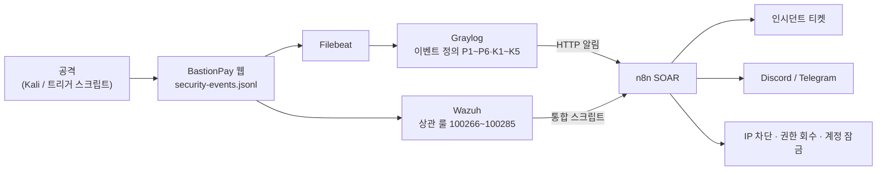

# cjy 작업 정리 — SIEM 관제 · SOAR 자동 대응

> BastionPay 프로젝트에서 **최재영(n8n SOAR · 탐지/대응)** 담당분의 작업과, 각 구성 요소를 처음부터 다시 세팅하는 방법 문서를 모은 폴더입니다.
> 프로젝트 전체 소개는 상위 [README.md](../README.md)를 보세요.

---

## 1. 한눈에 보기

공격 한 번이 **로그 → 탐지 → 자동 대응 → 복구**로 이어지는 관제 흐름을 맡았습니다.

| 영역 | 한 일 |
|---|---|
| 탐지 (Graylog) | 앱 로그·IDS 경보를 조건별로 탐지하는 이벤트 정의 구성, 등급 체계 정리 |
| 탐지 (Wazuh) | 앱 JSON 로그 수집, "기본 룰 → 상관 룰" 2단 탐지, FIM, n8n·Graylog 전달 |
| 대응 (n8n SOAR) | 경보 수신 → 정규화 → 검증 → 분기 → 티켓·알림·자동 차단 워크플로 |
| 검증 | 시나리오별 공격 트리거 스크립트로 탐지~대응~복구 재현 |
| 문서화 | 각 구성 요소를 새 환경에서 재구축하는 설정 가이드 |

---

## 2. 폴더 구성

| 경로 | 내용 |
|---|---|
| [HowToSetUp/](HowToSetUp/) | 구성 요소별 설정 가이드 (아래 3장) |
| [attack_trigger/](attack_trigger/) | 보안 이벤트 트리거 스크립트와 사용법 |
| [simScreenshot/](simScreenshot/) | 시뮬레이션 결과 캡처 (탐지 → 티켓 → Discord/Telegram) |
| [lab/](lab/) | 로컬 재현용 자료 |
| [회고.md](회고.md) | 개선점과 느낀 점 (문제 → 원인 → 해결 → 결과) |

### 2-1. 설정 가이드 ([HowToSetUp/](HowToSetUp/))
| 문서 | 내용 |
|---|---|
| [web-server-setup.md](HowToSetUp/web-server-setup.md) | 웹 앱(8080)·MockBank(8090)·DB 실행, 테스트 데이터, 인증서 |
| [pfsense-setup.md](HowToSetUp/pfsense-setup.md) | VLAN·OpenVPN TAP·방화벽·NAT 망 분리 |
| [graylog-setup.md](HowToSetUp/graylog-setup.md) | 수집 입력·스트림·파이프라인·이벤트 정의, within/every/grace |
| [wazuh-setup.md](HowToSetUp/wazuh-setup.md) | Manager·Agent 설정, 디코더·룰, n8n·Graylog 전달 |
| [n8n-setup.md](HowToSetUp/n8n-setup.md) | SOAR 워크플로 구성, Credential, 노드별 설정, 테스트 |

### 2-2. 공격 트리거 ([attack_trigger/](attack_trigger/))
| 파일 | 내용 |
|---|---|
| [bastionpay_targeted_triggers.sh](attack_trigger/bastionpay_targeted_triggers.sh) | 시나리오 6종을 실제 요청으로 재현하는 메뉴형 스크립트 |
| [README.md](attack_trigger/README.md) | 트리거별 공격·탐지·복구 설명 |

### 2-3. 재현용 자료 ([lab/](lab/))
| 파일 | 내용 |
|---|---|
| [bastionpay-content-pack-local.json](lab/bastionpay-content-pack-local.json) | 기존 Graylog와 겹치는 항목을 뺀 콘텐츠 팩(한 PC 재현용) |

---

## 3. 탐지·대응 체계 요약

### 3-1. Graylog 이벤트 정의
앱 로그(`filebeat_` 접두사)와 IDS 로그(접두사 없음)를 구분해 탐지합니다.

| 규칙 | 탐지 | 등급 | 대응 |
|---|---|---|---|
| P1 반복 로그인 실패 | 같은 IP·계정 10분 5회 | MEDIUM | 티켓 |
| P2 다중 계정 로그인 실패 | 같은 IP·다른 계정 5분 5개 | MEDIUM | 티켓 |
| P3 반복 이체 실패·환불 | 같은 IP 10분 2건 | 로그 등급 | 티켓 |
| P5 동일 계정 이체 요청 급증 | 같은 회원 5분 5건 | LOW | 티켓 |
| P6 서버 API 인증 실패 | 같은 IP 5분 3건 | MEDIUM | 운영자 알림(티켓 없음) |
| K1 웹 스캐너 | 1분에 다른 경로 15개 401 | LOW | 티켓 |
| K2 Hydra 브루트포스 | 1분 로그인 실패 5건 | MEDIUM | 티켓 |
| K3 Suricata 경보 폭주 | IDS 경보 폭주 | HIGH | 티켓 |
| K4 저속 브루트포스 | 30분 8건 | MEDIUM | 티켓 |
| K5 네트워크 포트스캔 | Snort 포트스캔 | MEDIUM | 티켓 |
| P4a ADMIN 권한 탈취 시도 | 무단 관리자 접근 | HIGH | 티켓 + IP 차단 |
| P4b 비정상 ADMIN 권한 승급 | 사유 없는 등급 변경 | CRITICAL | 티켓 + Telegram + 권한 회수 + 계정 잠금 |

> 티켓 등급은 Graylog 이벤트 정의의 `severity` 값을 따릅니다. HIGH 이상이면 n8n이 IP를 자동 차단하므로, 차단까지 원하지 않는 규칙은 MEDIUM 이하로 둡니다. 자세한 기준은 [graylog-setup.md 9장](HowToSetUp/graylog-setup.md#9-within--every--grace-정하기).

### 3-2. n8n SOAR 워크플로 (`BastionPay - Security Alert Intake`)
1. **수신**: Graylog·Wazuh 웹훅 2개, 즉시 202 응답
2. **정규화**: 서로 다른 두 형식을 공통 필드로 변환
3. **검증·분류**: 정상 로그 폐기, 모르는 경보는 수동 검토, API 오류는 운영자 알림
4. **대응**: 티켓 생성 → Discord(전체) / Telegram(CRITICAL) / IP 차단(HIGH+) / 권한 회수·계정 잠금(권한 승급)

원칙: **애매한 경보는 버리지 않고 사람에게 넘긴다.**

### 3-3. 공격 트리거로 검증
한 PC에서 웹·Graylog·n8n을 띄우고, 트리거 스크립트로 시나리오를 재현해 **탐지 → 티켓 → 알림 → 복구**까지 확인할 수 있습니다. 실행 방법은 [attack_trigger/README.md](attack_trigger/README.md).

---

## 4. 재현 순서 (새 환경)

1. [web-server-setup.md](HowToSetUp/web-server-setup.md) — 웹 앱과 DB를 먼저 띄웁니다.
2. [graylog-setup.md](HowToSetUp/graylog-setup.md) — 로그 수집과 탐지를 붙입니다.
3. [n8n-setup.md](HowToSetUp/n8n-setup.md) — 자동 대응 워크플로를 올립니다. (웹+Graylog+n8n만으로 핵심 흐름 확인 가능)
4. [wazuh-setup.md](HowToSetUp/wazuh-setup.md) — Wazuh 탐지 경로를 추가합니다.
5. [pfsense-setup.md](HowToSetUp/pfsense-setup.md) — 망 분리를 적용합니다.
6. [attack_trigger/](attack_trigger/) — 시나리오로 전체 흐름을 검증합니다.

---

## 5. 보안 주의사항

- **문서·git에 적지 않는 값**: API 키, Discord 웹훅 URL, Telegram 봇 토큰, Wazuh 웹훅 키, `.env`, 인증서 개인키(`.key`, `.p12`)
- 저장소의 `_wazuh/wazuh-config/n8n-webhook-key.txt`와 `ossec.conf`의 `<api_key>`에는 실제 웹훅 키가 들어 있습니다. 공개 저장소라면 **키를 교체하고 저장소에서 빼세요.**
- 콘텐츠 팩·pfSense 백업에는 내부 IP·인증서 등이 포함됩니다. 공개 범위에 주의합니다.
- 설정 가이드의 주소(`192.168.3.x`)와 호스트 이름은 이 실습 환경 기준입니다. 새 환경에서는 각 문서 안내대로 바꿔 읽으세요.
